<!-- Généré depuis Rapport_LIAS.tex — la version de référence est le PDF. -->


Université Hassan II de Casablanca}
Faculté des Sciences Ben M'Sik}
{4mm}
Master Data Science & Big Data}
Année universitaire 2025–2026}

{18mm}
{}
{8mm}

Projet de fin de module}
{3mm}
Java Enterprise Edition}

{10mm}
Plateforme de gestion[3mm] du laboratoire LIAS}

{7mm}
Laboratoire d'Informatique et Automatique\ pour les Systèmes}

{8mm}
{}

{14mm}
Site institutionnel public et système d'information interne
pour la gestion des membres, de la gouvernance, de l'activité
scientifique et de la mémoire administrative du laboratoire}


Réalisé par}
{1mm}
Douae Moussaoui}


Encadrement}
{1mm}
Équipe pédagogique du module JEE}


{12mm}
Casablanca — Septembre 2026}


{roman}
{plain}


# Remerciements

{Remerciements}


Je tiens à exprimer ma reconnaissance à l'équipe pédagogique du module Java Enterprise
Edition du Master Data Science & Big Data de la Faculté des Sciences Ben M'Sik, pour la
qualité de l'encadrement et pour un énoncé de projet suffisamment exigeant pour imposer
de véritables décisions d'architecture plutôt qu'un simple exercice de programmation.

Mes remerciements vont également au laboratoire LIAS, dont le fonctionnement réel —
statuts d'appartenance, mandats de gouvernance, mémoire documentaire — a servi de
cadre métier à ce travail et lui a donné sa consistance.

Je remercie enfin l'ensemble du corps enseignant du Master pour la formation dispensée
tout au long de l'année.


# Résumé

{Résumé}


Ce rapport présente la conception et la réalisation d'une plateforme web de gestion pour
le laboratoire de recherche LIAS, développée dans le cadre du module Java Enterprise
Edition du Master Data Science & Big Data. L'application remplit simultanément deux
fonctions : celle de site institutionnel public et celle de système d'information interne
couvrant l'ensemble du cycle de vie administratif et scientifique du laboratoire.

La difficulté centrale du sujet n'est pas la quantité de modules mais une exigence
structurelle du cahier des charges : la séparation stricte entre le STATUT d'appartenance
d'un membre, son MANDAT de gouvernance et le RÔLE applicatif qui gouverne ses
permissions. Cette contrainte a orienté toute la conception. Le rôle n'est jamais saisi
manuellement : il est *dérivé* du statut et des mandats actifs par un service
dédié, historisé à chaque changement, et réconcilié automatiquement au démarrage de
l'application.

La solution repose sur une architecture trois tiers : un backend Spring Boot 3.3
(Java 21) exposant 22 contrôleurs REST adossés à 31 entités JPA et à une base
PostgreSQL versionnée par Flyway ; une interface React 19 de 21 pages construite sur un
système de composants interne ; une couche de sécurité stateless fondée sur JWT,
BCrypt et un contrôle d'accès par rôle appliqué méthode par méthode. La traçabilité est
assurée par un journal d'audit et quatre tables d'historique, conformément à la règle du
cahier des charges selon laquelle aucune donnée n'est jamais perdue.

La validation combine 48 tests automatisés (aucun échec) et un audit fonctionnel de bout
en bout portant sur 21 routes et les 9 rôles du système. Les 21 sections du cahier des
charges sont couvertes ; les limites résiduelles, notamment l'absence de thème sombre et
de mesure de couverture de code, sont explicitement identifiées.

{4mm}
**Mots-clés** — Java Enterprise Edition ; Spring Boot ; JPA / Hibernate ;
React ; PostgreSQL ; JWT ; contrôle d'accès par rôle (RBAC) ; gouvernance de laboratoire ;
traçabilité ; historisation ; architecture trois tiers.


# Abstract

{Abstract}


This report describes the design and implementation of a web management platform for the
LIAS research laboratory, carried out as the final project of the Java Enterprise Edition
module of the Data Science & Big Data Master's programme. The application serves two
purposes at once: a public institutional website and an internal information system
covering the whole administrative and scientific lifecycle of the laboratory.

The core difficulty of the assignment is not the number of modules but a structural
requirement of the specification: the strict separation between a member's membership
*status*, their governance *mandate*, and the application *role* that
drives their permissions. This constraint shaped the entire design. The role is never set
by hand: it is *derived* from status and active mandates by a dedicated service,
historised on every change, and automatically reconciled at application start-up.

The solution follows a three-tier architecture: a Spring Boot 3.3 backend (Java 21)
exposing 22 REST controllers over 31 JPA entities and a PostgreSQL database versioned with
Flyway; a React 19 front end of 21 pages built on an in-house component system; and a
stateless security layer based on JWT, BCrypt and method-level role-based access control.
Traceability relies on an audit journal and four history tables, in line with the
specification rule that no data is ever lost.

Validation combines 48 automated tests (no failures) with an end-to-end functional audit
covering 21 routes and the 9 system roles. All 21 sections of the specification are
covered; remaining limitations — notably the absence of a dark theme and of a measured
code-coverage figure — are explicitly stated.

{4mm}
**Keywords** — Java Enterprise Edition; Spring Boot; JPA / Hibernate;
React; PostgreSQL; JWT; role-based access control; laboratory governance; traceability;
auditability; three-tier architecture.


{Liste des figures}


{Liste des tableaux}


# Liste des acronymes

{Liste des acronymes}


| **Acronyme** | **Signification** |
| --- | --- |
| **Acronyme** | **Signification** |
| API | *Application Programming Interface* — interface de programmation |
| BCrypt | Fonction de hachage de mots de passe à coût paramétrable |
| CdC | Cahier des charges |
| CDP | *Chrome DevTools Protocol* |
| CORS | *Cross-Origin Resource Sharing* |
| CRUD | *Create, Read, Update, Delete* |
| DTO | *Data Transfer Object* — objet de transfert |
| E2E | *End-to-End* — de bout en bout |
| HS512 | HMAC-SHA-512, algorithme de signature des jetons JWT |
| JEE | *Java Enterprise Edition* (aujourd'hui Jakarta EE) |
| JPA | *Jakarta Persistence API* |
| JPQL | *Jakarta Persistence Query Language* |
| JSON | *JavaScript Object Notation* |
| JWT | *JSON Web Token* |
| LIAS | Laboratoire d'Informatique et Automatique pour les Systèmes |
| ORM | *Object-Relational Mapping* — correspondance objet-relationnel |
| PV | Procès-verbal (de réunion) |
| RBAC | *Role-Based Access Control* — contrôle d'accès fondé sur les rôles |
| REST | *Representational State Transfer* |
| SGBD | Système de gestion de base de données |
| SPA | *Single-Page Application* |
| SMTP | *Simple Mail Transfer Protocol* |
| SQL | *Structured Query Language* |
| UML | *Unified Modeling Language* |
| UUID | *Universally Unique Identifier* |


{arabic}
{page}{1}
{fancy}


# Introduction générale


## Contexte général


Le LIAS — Laboratoire d'Informatique et Automatique pour les Systèmes — est une
structure de recherche rattachée à la Faculté des Sciences Ben M'Sik de l'Université
Hassan II de Casablanca. Comme toute unité de recherche, il fonctionne sur deux plans
distincts et rarement outillés ensemble.

Sur le plan externe, le laboratoire doit être visible : un visiteur, un candidat à une
thèse ou un partenaire industriel doit pouvoir consulter la composition des équipes, la
production scientifique et le calendrier des manifestations sans disposer d'un compte.

Sur le plan interne, le laboratoire produit en permanence de l'information administrative
dont la valeur est cumulative : des membres entrent, changent de statut, prennent des
responsabilités, partent puis reviennent parfois ; des mandats de direction se succèdent ;
des documents, des procès-verbaux et des conventions s'accumulent et doivent rester
retrouvables plusieurs années après. Cette information est, dans la pratique courante,
dispersée entre tableurs, messageries et dossiers partagés — des supports qui ne
conservent ni l'ordre chronologique des décisions ni leur auteur.


## Problématique


Le cahier des charges du projet formule une exigence qui dépasse la simple numérisation
de ces pratiques. Sa section 21 énonce quatre règles générales : aucun membre ne perd ses
données, tout est historisé, toute action importante est traçable, et surtout une
séparation stricte doit être maintenue entre le STATUT d'appartenance d'un membre
(permanent, associé, doctorant) et son RÔLE de responsabilité.

Cette dernière règle est la véritable difficulté du sujet. Dans une application de gestion
classique, le rôle applicatif est un champ que l'administrateur renseigne. Ici, il ne peut
pas l'être, pour une raison métier : un enseignant-chercheur *permanent* qui devient
directeur du laboratoire ne cesse pas d'être permanent ; il acquiert, pour une période
datée, une responsabilité supplémentaire. À la fin de son mandat, il redevient un membre
permanent ordinaire sans que rien n'ait été effacé. Trois notions coexistent donc et
évoluent à des rythmes différents :


- le STATUT — une catégorie d'appartenance, qui change lentement ;
- le MANDAT — une responsabilité de gouvernance bornée par deux dates ;
- le RÔLE — l'ensemble des permissions que la sécurité applicative lit à chaque
 requête.


La problématique du projet se formule alors ainsi : {comment construire un système
d'information dans lequel les permissions techniques découlent automatiquement et de
manière vérifiable de la réalité institutionnelle du laboratoire, sans jamais détruire
l'historique qui les justifie ?}


## Objectifs


Les objectifs poursuivis découlent directement de la section 1 du cahier des charges et
sont repris au tableau 1.1.


**Tableau 1.1** — Objectifs du système et traduction technique retenue

| **Objectif (CdC §1)** | **Traduction dans le système** |
| --- | --- |
| Centraliser la gestion du laboratoire | Une base relationnelle unique, 22 contrôleurs REST, une interface unifiée pour 18 modules métier |
| Assurer la traçabilité des activités | Journal d'audit systématique (acteur, action, entité, horodatage, adresse IP) |
| Capitaliser la mémoire du laboratoire | Suppression logique généralisée, quatre tables d'historique, archivage documentaire versionné |
| Structurer membres et responsabilités | Séparation STATUT / RÔLE / MANDAT avec dérivation automatique du rôle |
| Faciliter le rapport annuel obligatoire | Agrégation automatique des indicateurs et export PDF, déclenché manuellement ou par planification annuelle |
| Améliorer la collaboration | Discussions à trois portées, notifications ciblées, calendrier unifié |


## Présentation du projet LIAS


La plateforme réalisée est une application web unique servant deux publics. Sa partie
publique, accessible sans authentification, présente le laboratoire, ses équipes, ses
publications et ses événements, et permet le dépôt d'une candidature d'adhésion. Sa partie
interne, protégée par authentification, donne accès à dix-huit modules de gestion dont
l'étendue dépend du rôle effectif de l'utilisateur connecté.

Le système reconnaît neuf rôles applicatifs et cinq statuts d'appartenance, articulés par
trois types de mandats de gouvernance. Il gère 31 entités persistantes réparties en 30
tables, dont quatre tables d'historique et une table d'audit. L'ensemble représente
environ 9 900 lignes de Java côté serveur et 13 100 lignes de JavaScript côté client.


## Méthodologie de travail


Le projet a été conduit de manière incrémentale, chaque incrément étant validé avant le
suivant. Quatre phases se sont succédé.


1. **Analyse et modélisation.** Lecture du cahier des charges, identification
 des acteurs et des règles métier, établissement du modèle de données. C'est à ce
 stade qu'a été prise la décision structurante de faire du rôle une donnée dérivée
 plutôt qu'une donnée saisie.
2. **Construction du socle.** Schéma relationnel versionné par Flyway, entités
 JPA, couche de sécurité, puis modules métier ajoutés un à un selon un découpage
 constant contrôleur / service / repository.
3. **Réalisation de l'interface.** Mise en place d'un système de composants
 réutilisables, puis des 21 pages, chacune connectée à des endpoints réels — le
 cahier des charges proscrivant explicitement les maquettes et les données fictives.
4. **Validation.** Audit fonctionnel de bout en bout sur les 21 routes et les
 neuf rôles, correction des défauts constatés, puis écriture de tests automatisés
 verrouillant les règles métier les plus sensibles.


Cette dernière phase a joué un rôle particulier. Elle a mis au jour des défauts qu'aucune
lecture de code n'avait révélés : une dérive de rôle sur des comptes créés avant
l'introduction du service de dérivation, des réponses d'erreur mal formées sur le chemin
d'authentification, et des commandes visibles par un vice-directeur alors que le serveur
les lui refusait. Ces corrections sont documentées au chapitre 8.


## Organisation du rapport


Le rapport suit la progression du projet. Le chapitre 2 analyse les besoins
et formalise les acteurs et les exigences. Le chapitre 3 présente
l'architecture et la modélisation UML. Le chapitre 4 justifie les choix
technologiques, en particulier le rattachement de Spring Boot à l'écosystème JEE. Les
chapitres 5 et 6 détaillent la réalisation du serveur puis
de l'interface. Le chapitre 7 traite de la sécurité et de la traçabilité.
Le chapitre 8 expose la stratégie de validation et ses résultats. Le
chapitre 9 confronte le réalisé au cahier des charges et énonce les
limites, avant le bilan du chapitre 10.


# Analyse des besoins et cahier des charges


## Présentation du contexte


Le cahier des charges se compose de 21 sections décrivant, dans l'ordre, les objectifs du
système, la typologie des utilisateurs, la gestion des profils, les données temporelles,
la gouvernance, puis quinze modules fonctionnels, et se termine par un ensemble de règles
générales. Sa lecture fait apparaître une structure en trois couches : une couche
d'identité et de gouvernance, une couche d'activité scientifique, et une couche de
ressources et de traçabilité. Ce découpage a été conservé jusque dans l'organisation des
packages Java et dans la répartition des diagrammes de classes.

Une caractéristique de l'énoncé mérite d'être relevée : il ne décrit jamais d'écran. Il
décrit des règles de fonctionnement institutionnel — « historique complet conservé »,
« uniquement par le directeur en mandat », « qui a reçu / qui n'a pas reçu ». L'analyse a
donc consisté à traduire des règles de gestion en contraintes vérifiables par le système,
et non à transposer une maquette.


## Acteurs du système


Le cahier des charges distingue les visiteurs des membres, et détaille cinq catégories de
membres ainsi que trois responsabilités de gouvernance et un administrateur technique. Le
tableau 2.1 recense les acteurs effectivement implémentés, avec le rôle
applicatif correspondant dans l'énumération `RoleName`.


**Tableau 2.1** — Acteurs du système et rôles applicatifs correspondants

| **Acteur** | **`RoleName`** | **Périmètre d'accès** |
| --- | --- | --- |
| Visiteur | — (anonyme) | Portail public, dépôt d'une candidature d'adhésion |
| Doctorant | `PHD_STUDENT` | Profil, membres, publications (ajout et consultation), événements, calendrier, notifications. *Aucun accès aux modules internes* |
| Membre associé | `ASSOCIATE_MEMBER` | Le précédent, plus documents, matériel et procès-verbaux |
| Membre permanent | `PERMANENT_MEMBER` | Identique au membre associé |
| Chef d'équipe | `TEAM_LEADER` | Le précédent, plus création d'événements et de réunions, dépôt de procès-verbaux |
| Vice-directeur | `VICE_DIRECTOR` | Le précédent, plus validation des demandes de matériel, statuts, conventions, rapports, journal d'audit, inventaire |
| Directeur | `DIRECTOR` | Le précédent, plus décision sur les adhésions, gestion des équipes et attribution des mandats |
| Retraité | `RETIRED_MEMBER` | Compte gelé : authentification refusée, historique conservé |
| Ancien membre | `FORMER_MEMBER` | Compte désactivé, réactivable |
| Administrateur système | `SYSTEM_ADMIN` | Administration technique : comptes, rôles, identité du laboratoire. Pas de compétence métier |


La distinction entre l'administrateur système et le directeur mérite d'être soulignée : le
cahier des charges leur attribue des responsabilités de nature différente (§5.1 et §5.2).
L'administrateur gère la technique, le directeur gouverne le laboratoire. Cette séparation
a été conservée jusque dans les annotations de sécurité : l'administrateur système ne peut
pas statuer sur une demande d'adhésion, et le directeur ne peut pas créer de compte
technique.

La figure 2.1 présente le diagramme de cas d'utilisation. Il a été construit
à partir des annotations `@PreAuthorize` réellement présentes sur les contrôleurs et
du fichier de garde `utils/roles.js` côté client : chaque flèche correspond donc à un
endpoint effectivement exposé et autorisé, et non à une intention.


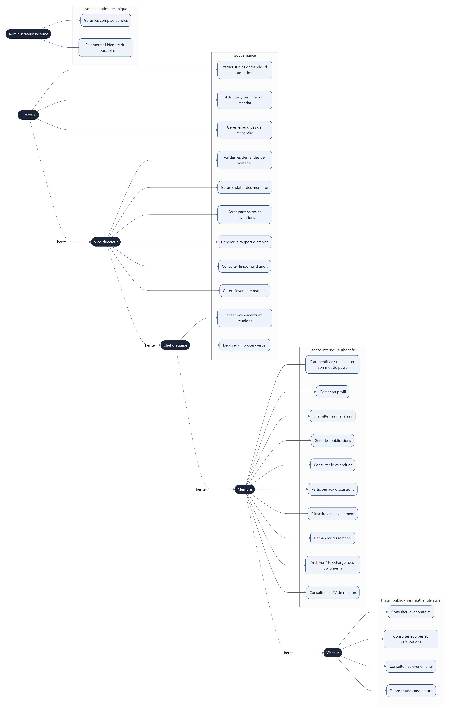

**Figure 2.1** — Diagramme de cas d'utilisation du système LIAS


L'organisation du diagramme traduit une relation d'héritage entre acteurs : le membre
hérite du visiteur, le chef d'équipe du membre, le vice-directeur du chef d'équipe et le
directeur du vice-directeur. Chaque niveau ajoute des cas d'utilisation sans en retirer.
L'administrateur système est délibérément placé hors de cette chaîne, avec ses deux seuls
cas d'utilisation propres.


## Besoins fonctionnels


Les besoins fonctionnels sont issus des sections 3 à 20 du cahier des charges. Le
tableau 2.2 les regroupe en huit domaines et précise l'exigence
caractéristique de chacun — celle qui, si elle n'était pas satisfaite, rendrait le
module non conforme.


**Tableau 2.2** — Besoins fonctionnels par domaine et exigence caractéristique

| **§ CdC** | **Domaine** | **Exigence caractéristique** |
| --- | --- | --- |
| 3, 4 | Profils et données temporelles | Un membre peut quitter le laboratoire et revenir ; chaque période d'affiliation est conservée séparément |
| 5, 7 | Gouvernance et rôles | Les mandats définissent des périodes datées ; l'historique complet des rôles est conservé |
| 6 | Demandes d'adhésion | La décision revient *uniquement* au directeur en mandat ; l'acceptation crée le compte |
| 8 | Départ et retraite | Le compte est gelé ou désactivé, jamais supprimé ; la réactivation reste possible |
| 9, 12, 17, 20 | Activité scientifique | Les événements sont archivés *par édition* ; les publications sont classables par auteur, année et équipe |
| 10 | Archivage documentaire | Les documents sont structurés par événement et par date, et historisés en versions |
| 11 | Rapport annuel | Génération *automatique* à partir des événements, publications et activités |
| 13–16, 18, 19 | Ressources et communication | Le suivi du matériel doit indiquer qui a reçu *et qui n'a pas reçu* |


Deux exigences ont eu un effet structurant disproportionné par rapport à leur longueur
dans l'énoncé. La première est l'archivage par édition (§9) : elle impose que deux
occurrences successives d'un même colloque coexistent sans écrasement, ce qui se traduit
par un attribut `editionNumber` et un endpoint dédié. La seconde est le suivi des
non-bénéficiaires de matériel (§14) : elle exige une requête calculant un complément
d'ensemble — les membres actifs n'ayant pas reçu un article donné — et non une simple
lecture de table.


## Besoins non fonctionnels


Le document de spécification associé au cahier des charges énumère un ensemble d'exigences
non fonctionnelles. Le tableau 2.3 en donne l'état réel, sans complaisance :
une exigence non satisfaite y est déclarée comme telle et reprise dans les limites
(§9.4).


**Tableau 2.3** — Besoins non fonctionnels et niveau de satisfaction atteint

| **Exigence** | **État** | **Élément justificatif** |
| --- | --- | --- |
| Sécurité | Satisfait | JWT signé HS512, BCrypt (coût 12), contrôle d'accès par rôle appliqué méthode par méthode, gel des comptes vérifié à chaque requête |
| Architecture propre | Satisfait | 18 packages métier, séparation contrôleur / service / repository / DTO systématique |
| API REST | Satisfait | 22 contrôleurs sous `/api/v1`, documentation OpenAPI générée |
| Composants réutilisables | Satisfait | Système de composants interne (7 modules) réutilisé par les 21 pages |
| Design responsive | Satisfait | Navigation en tiroir sous 1024 px, tables à défilement horizontal encapsulé |
| Interface professionnelle | Satisfait | Identité visuelle unique appliquée à l'ensemble des écrans |
| Maintenabilité | Satisfait | Découpage constant, 48 tests verrouillant les règles critiques |
| Performance | Partiel | `open-in-view` désactivé, pagination serveur, index SQL ; aucune campagne de charge menée |
| Accessibilité | Partiel | Libellés accessibles sur les boutons-icônes, focus visible, fermeture clavier des modales ; pas d'audit WCAG formel |
| Thème sombre | **Non satisfait** | Non implémenté — limite assumée (§9.4) |


## Contraintes


Quatre contraintes ont encadré la réalisation.


**Contrainte académique.**  Le projet relève d'un module Java Enterprise Edition :
la plateforme technique du backend est imposée dans son principe. Le choix de Spring Boot
comme implémentation des spécifications JEE est justifié au chapitre 4.


**Contrainte de conservation.**  La règle « aucun membre ne perd ses données »
interdit la suppression physique. Elle se traduit par une suppression logique généralisée
au niveau de la classe de base des entités, et impose de traiter partout le cas d'une
entité archivée encore référencée par une autre.


**Contrainte d'authenticité des données.**  Le document de spécification proscrit
explicitement les maquettes, les données fictives et les pages de remplissage. Chaque
écran présenté dans ce rapport est connecté à des endpoints réels interrogeant la base de
données.


**Contrainte d'exécution.**  L'application devait fonctionner sur une base
PostgreSQL hébergée, avec un schéma versionné et validé au démarrage — ce qui interdit
la génération automatique du schéma par l'ORM et impose des migrations explicites.


## Critères de réussite


Les critères retenus pour juger le projet abouti, et vérifiés au chapitre 8,
sont les suivants :


1. les 21 sections du cahier des charges sont couvertes par une fonctionnalité
 opérationnelle, et non par une page vide ;
2. la séparation STATUT ≠ RÔLE ≠ MANDAT est vérifiable : aucun compte
 ne présente d'écart entre son rôle stocké et le rôle que son statut et ses mandats
 impliquent ;
3. les permissions du client et celles du serveur coïncident : aucune commande
 visible ne doit aboutir à un refus, aucune opération autorisée ne doit être
 masquée ;
4. un compte retraité ou ancien ne peut plus accéder au système, alors que son
 historique demeure consultable ;
5. la compilation, la construction du client et la suite de tests s'exécutent sans
 erreur.


# Conception et modélisation


Les diagrammes présentés dans ce chapitre ont été produits à partir du code final et non
l'inverse : les classes, les attributs et les cardinalités ont été relevés dans les entités
JPA, et les enchaînements du diagramme de séquence dans le corps des méthodes concernées.
Ils décrivent donc le système tel qu'il est, y compris lorsque cela révèle un choix
discutable.


## Architecture générale


L'application adopte une architecture trois tiers classique, mais dont la couche de
sécurité présente une particularité : elle est traversée à chaque requête, et non
seulement à la connexion. La figure 3.1 en donne la vue d'ensemble.


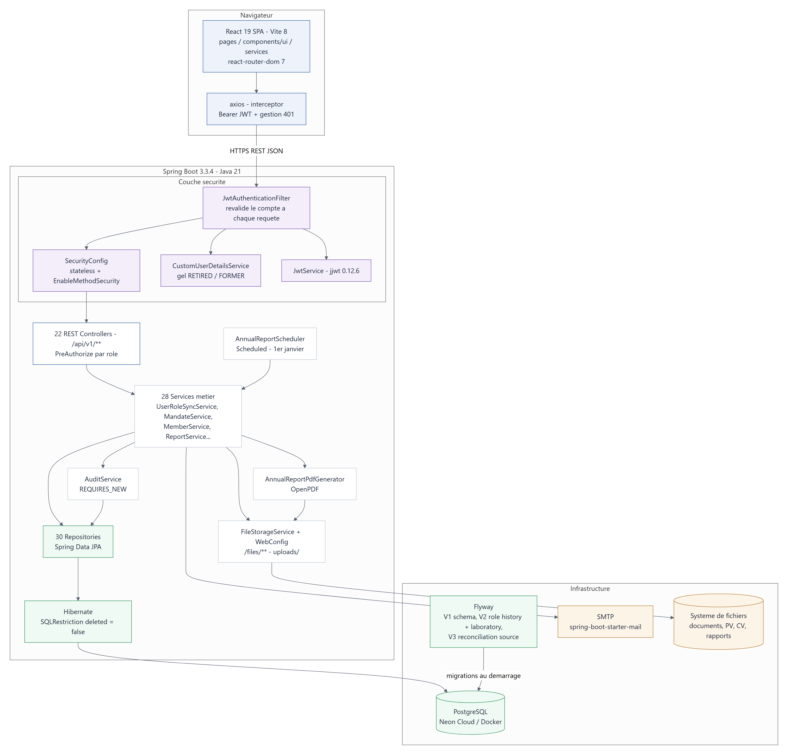

**Figure 3.1** — Architecture applicative en trois tiers


Le client est une application monopage React communiquant exclusivement en JSON avec le
serveur. Un intercepteur Axios attache le jeton d'authentification à chaque appel et
intercepte les réponses `401` pour ramener l'utilisateur à l'écran de connexion.

Le serveur est organisé en quatre niveaux. Le filtre `JwtAuthenticationFilter`
s'exécute avant tout traitement métier ; les contrôleurs REST portent les règles
d'autorisation ; les services concentrent la logique métier et les transactions ; les
repositories Spring Data assurent la persistance. Deux services transversaux se
distinguent : `AuditService`, qui écrit dans une transaction indépendante pour que la
trace subsiste même si l'opération auditée échoue, et `FileStorageService`, qui isole
le stockage disque derrière une abstraction unique.

L'infrastructure comprend une base PostgreSQL dont le schéma est créé et versionné par
Flyway au démarrage, un serveur SMTP pour l'envoi des identifiants et des notifications,
et un répertoire de stockage pour les fichiers déposés. L'interprétation à retenir de
cette figure est que le chemin de sécurité n'est pas contournable : aucune flèche ne relie
directement le client aux contrôleurs.


## Diagramme de cas d'utilisation


Le diagramme de cas d'utilisation a été présenté au chapitre précédent
(figure 2.1) car il constitue le résultat direct de l'analyse des acteurs. Il
est rappelé ici que sa construction est *descendante depuis le code* : chaque
association acteur–cas d'utilisation est adossée à une annotation d'autorisation
existante.


## Diagramme de classes


Le modèle comporte 31 entités persistantes. Les représenter sur une seule planche aurait
produit une figure illisible en format A4 ; le diagramme a donc été scindé en quatre vues
cohérentes correspondant aux trois couches identifiées lors de l'analyse. Toutes les
entités héritent d'une classe abstraite `BaseEntity` portant l'identifiant UUID, les
métadonnées d'audit JPA (dates et auteurs de création et de modification), le numéro de
version optimiste et les deux champs de suppression logique.


### Identité et gouvernance


La figure 3.2 présente la vue centrale du modèle, celle où se lit la
séparation exigée par le cahier des charges.


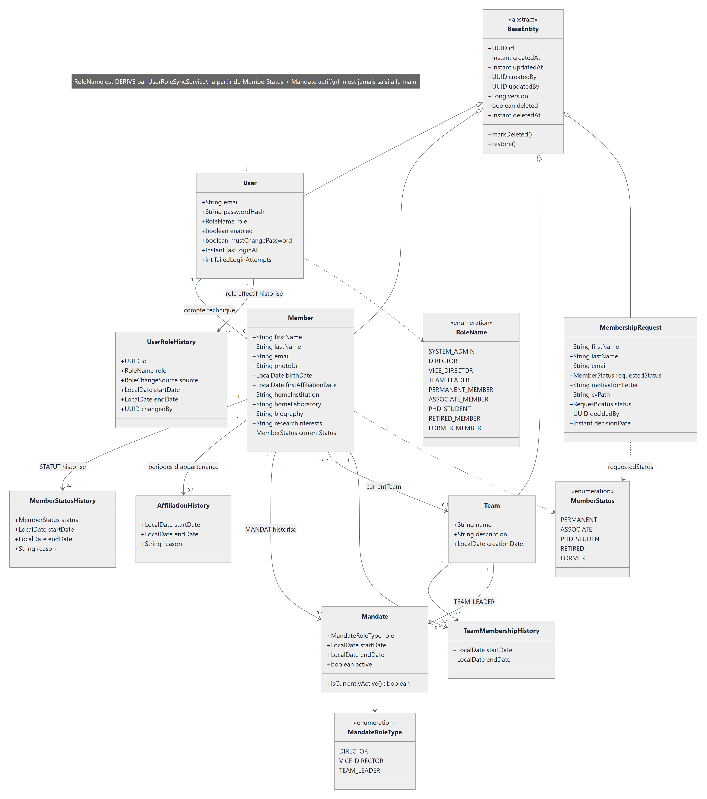

**Figure 3.2** — Diagramme de classes — identité, membres et gouvernance


Trois observations structurent la lecture de cette figure.

D'abord, `User` et `Member` sont deux entités distinctes reliées par une
association *un à zéro-ou-un*. Un `User` est un compte d'authentification ; un
`Member` est un profil scientifique. La cardinalité *zéro-ou-un* n'est pas un
artefact : elle autorise l'existence d'un compte purement technique, l'administrateur
système, qui n'est pas un chercheur du laboratoire.

Ensuite, trois associations partent de `Member` vers des tables d'historique :
`MemberStatusHistory` pour le statut, `AffiliationHistory` pour les périodes
d'appartenance et `Mandate` pour les responsabilités. Une quatrième,
`UserRoleHistory`, part de `User` et enregistre le rôle applicatif. Cette
disposition matérialise la séparation : le statut, le mandat et le rôle sont historisés
*séparément* parce que ce sont trois concepts distincts qui évoluent indépendamment.

Enfin, la note attachée à `User` porte la règle la plus importante du modèle :
l'attribut `role` est dérivé par `UserRoleSyncService` à partir du statut et des
mandats actifs, et n'est jamais saisi manuellement. Un lecteur du seul schéma relationnel
ne pourrait pas le deviner — d'où sa présence explicite sur le diagramme.


### Activité scientifique


La figure 3.3 regroupe les entités qui portent la production du
laboratoire.


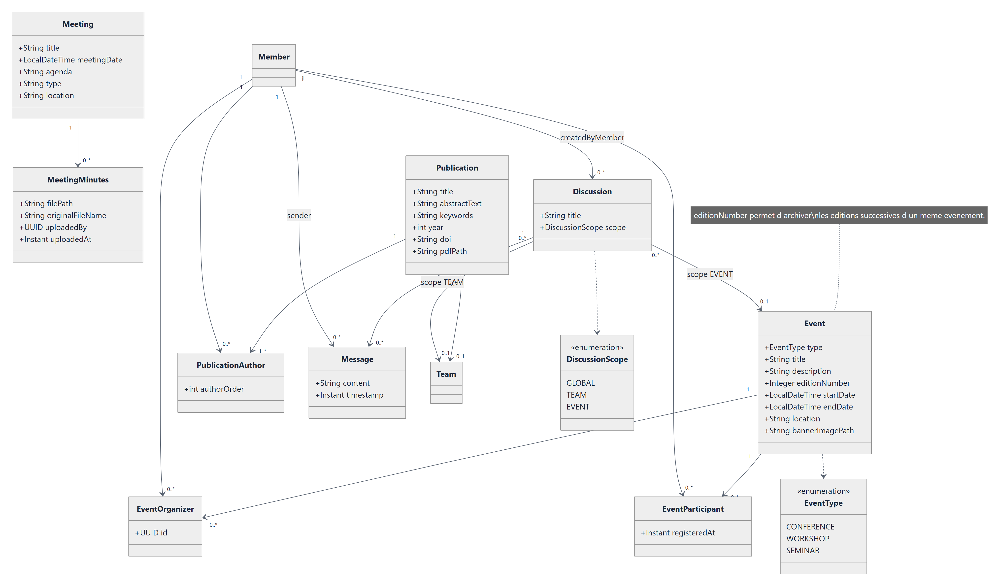

**Figure 3.3** — Diagramme de classes — activité scientifique


Deux choix de modélisation y sont visibles. `PublicationAuthor` est une classe
d'association entre `Publication` et `Member` : elle porte un attribut
`authorOrder` car l'ordre des signataires d'un article est une information
scientifique significative qu'une simple relation plusieurs-à-plusieurs perdrait. De même,
`EventOrganizer` et `EventParticipant` sont distinctes : organiser un événement
et s'y inscrire ne sont pas la même chose et ne relèvent pas des mêmes droits.

L'attribut `editionNumber` de `Event` répond à l'exigence d'archivage par édition
du cahier des charges : deux éditions successives d'un même colloque sont deux lignes
autonomes reliées par leur titre, et non un enregistrement écrasé.


### Ressources du laboratoire


La figure 3.4 couvre les documents, le matériel et les partenariats.


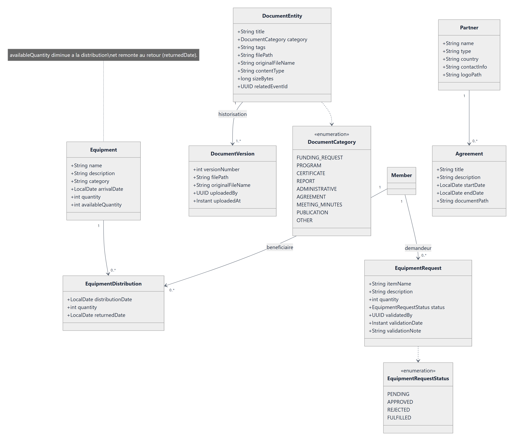

**Figure 3.4** — Diagramme de classes — documents, matériel et partenariats


La relation `DocumentEntity` `1..*` `DocumentVersion` traduit l'exigence
d'historisation documentaire : un document n'est jamais remplacé, une version lui est
ajoutée. La note portée sur `Equipment` rappelle l'invariant de stock
— `availableQuantity` diminue à la distribution et remonte au retour — dont la
vérification fait l'objet de tests dédiés (§8.7).


### Traçabilité et pilotage


La figure 3.5 rassemble les entités transverses.


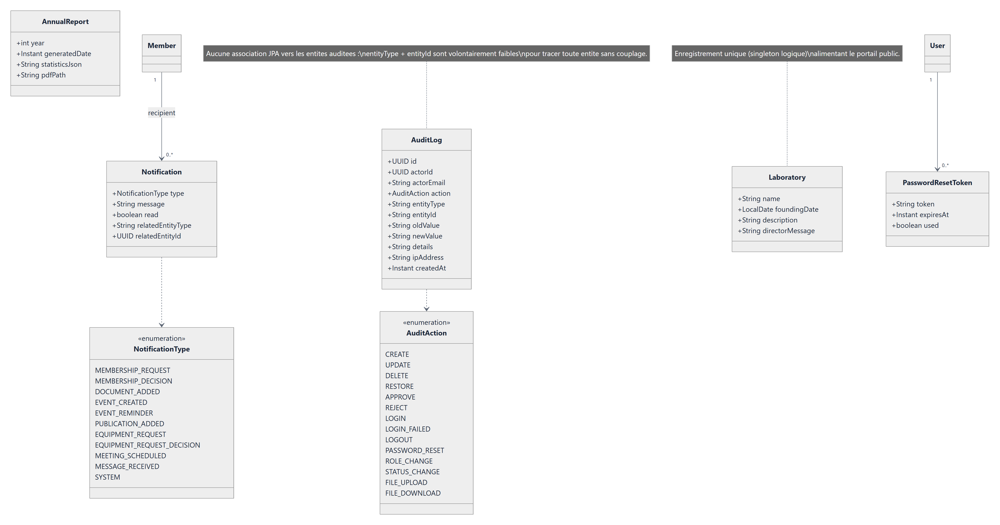

**Figure 3.5** — Diagramme de classes — traçabilité, notifications et pilotage


`AuditLog` présente une particularité assumée, signalée par une note : cette entité
n'a *aucune* association JPA vers les entités auditées. Elle mémorise un couple
`entityType` / `entityId` sous forme de chaînes. Ce couplage volontairement
faible permet de tracer n'importe quelle entité, y compris une entité archivée, sans que
la suppression logique de la cible ne rende la trace inexploitable. C'est un compromis :
on renonce à l'intégrité référentielle pour garantir la pérennité de la trace.


## Diagramme de séquence


Le scénario retenu est l'attribution d'un mandat de directeur. C'est l'opération la plus
délicate du système : elle met en jeu deux membres, clôt un mandat, en ouvre un autre et
recalcule deux rôles applicatifs, le tout sans qu'aucun rôle ne soit saisi. La
figure 3.6 en donne le déroulement exact, relevé dans
`MandateService.assign()` et `UserRoleSyncService`.


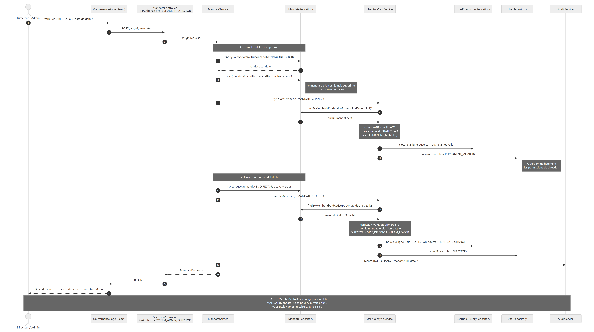

**Figure 3.6** — Diagramme de séquence — attribution d'un mandat de directeur


Le scénario se lit en deux temps, matérialisés par les deux blocs du diagramme.

Le premier temps assure l'unicité du titulaire. Le service recherche le mandat de directeur
actif ; s'il en existe un, il le *clôt* en positionnant sa date de fin et son
indicateur d'activité, sans jamais le supprimer — la note de droite le rappelle. Il
demande ensuite au service de synchronisation de recalculer le rôle de l'ancien titulaire.
Celui-ci, n'ayant plus de mandat actif, retrouve le rôle dérivé de son seul statut, par
exemple `PERMANENT_MEMBER`. Le point important est que la perte des permissions de
direction est immédiate et automatique : elle ne dépend d'aucune action d'administration.

Le second temps ouvre le mandat du nouveau titulaire et déclenche le même recalcul. La note
centrale explicite la règle de priorité appliquée par `computeEffectiveRole` : un
statut gelé (retraité ou ancien membre) l'emporte sur tout, faute de quoi le mandat le plus
élevé gagne, selon l'ordre directeur $>$ vice-directeur $>$ chef d'équipe.

Chaque changement ouvre une ligne dans l'historique des rôles avec sa cause
(`MANDATE_CHANGE`), et l'opération complète est journalisée. La note finale résume
l'invariant que ce scénario doit préserver : le statut des deux membres est inchangé, le
mandat est clos pour l'un et ouvert pour l'autre, et seul le rôle — donnée dérivée — a
été recalculé.


## Diagramme d'états


Le cycle de vie d'un membre, de la candidature publique au départ ou à la retraite,
est présenté en figure 3.7. Les états correspondent exactement aux valeurs des
énumérations `MemberStatus` et `RequestStatus` ; aucun état intermédiaire n'a été
ajouté pour la beauté du schéma.


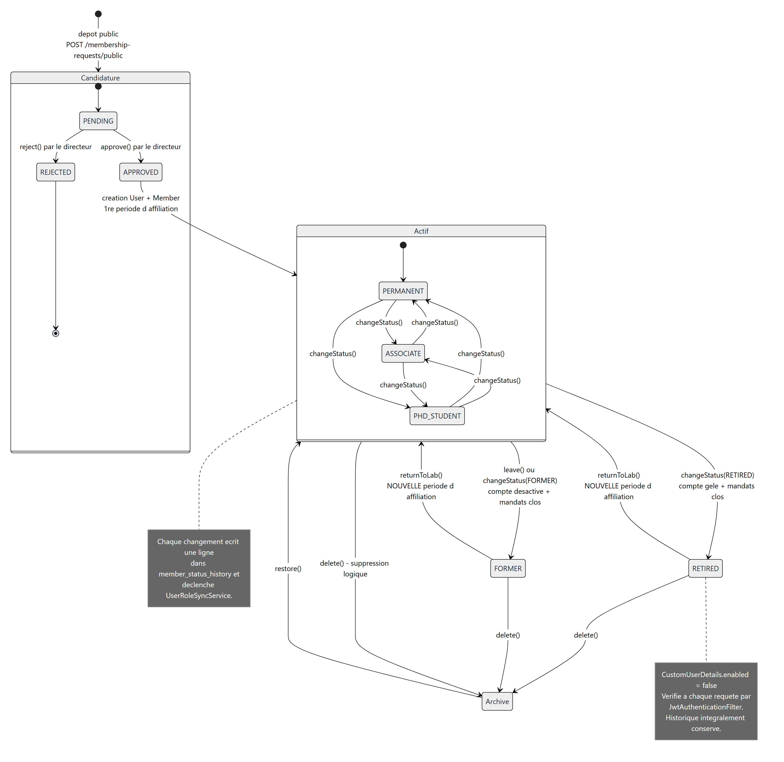

**Figure 3.7** — Diagramme d'états — cycle de vie d'un membre


Trois enseignements se dégagent de cette figure.

Le composite *Actif* regroupe les trois statuts entre lesquels un membre peut
librement circuler par un changement de statut. Ces transitions sont réversibles et toutes
historisées.

Les transitions vers `RETIRED` et `FORMER` sont les seules à produire un effet de
bord sur la sécurité : elles gèlent le compte et clôturent les mandats en cours. La note
attachée rappelle que ce gel est vérifié à chaque requête par le filtre d'authentification,
et non uniquement à la connexion — un jeton encore valide ne permet donc pas de
contourner une mise à la retraite prononcée entre-temps.

Les transitions de retour, déclenchées par `returnToLab()`, n'annulent pas le départ :
elles ouvrent une *nouvelle* période d'affiliation. C'est la traduction directe de la
règle §4.3 du cahier des charges, selon laquelle un membre peut quitter le laboratoire et
revenir sans que l'épisode précédent ne disparaisse.


## Modèle de données


Le schéma relationnel compte 30 tables créées par trois migrations Flyway successives. Le
tableau 3.1 en donne la répartition.


**Tableau 3.1** — Migrations Flyway et contenu du schéma

| **Version** | **Objet** | **Contenu** |
| --- | --- | --- |
| V1 | Schéma initial | 28 tables : identité, membres, gouvernance, activité scientifique, ressources, notifications, audit |
| V2 | Historique des rôles et identité du laboratoire | `user_role_history`, `laboratory` |
| V3 | Source de réconciliation | Extension de la contrainte `CHECK` sur `user_role_history.source` pour admettre la valeur `RECONCILIATION` |


Le schéma répond aux exigences de normalisation du document de spécification : clés
primaires en UUID, clés étrangères explicites, index sur les colonnes de recherche
fréquente, contraintes `CHECK` sur les colonnes portant des énumérations, et tables
d'historique et d'audit dédiées. L'ORM est configuré en mode `validate` : Hibernate
vérifie la concordance entre les entités et le schéma au démarrage, mais ne le modifie
jamais. Toute évolution passe donc obligatoirement par une migration versionnée — ce qui
rend le schéma reproductible d'un environnement à l'autre.


## Architecture de sécurité


La sécurité repose sur trois principes de conception, détaillés au
chapitre 7 et introduits ici parce qu'ils relèvent de l'architecture.


**Authentification sans état.**  Aucune session serveur n'est conservée. Le client
présente un jeton signé à chaque requête. Cela simplifie le déploiement mais implique que
la révocation ne peut pas reposer sur la destruction d'une session.


**Autorité de la base plutôt que du jeton.**  C'est le choix le plus important. Le
jeton transporte bien un rôle, mais ce rôle *n'est pas utilisé* pour autoriser : à
chaque requête, le filtre recharge l'utilisateur depuis la base et reconstruit ses
habilitations. Un changement de rôle ou une mise à la retraite prend donc effet à la
requête suivante, sans attendre l'expiration du jeton. Le coût est une lecture
supplémentaire par requête ; le bénéfice est qu'un jeton ne peut pas survivre à la
révocation des droits qu'il transportait.


**Autorisation au plus près du métier.**  Les règles d'accès ne sont pas centralisées
dans une table de correspondance URL / rôle, mais déclarées par annotation sur chaque
méthode de contrôleur. La règle est ainsi lisible à côté du code qu'elle protège, ce qui
réduit le risque de divergence lors d'une évolution.


# Choix technologiques et environnement


## Backend


Le serveur est construit sur Spring Boot 3.3.4 et Java 21 (LTS). Cette section justifie ce
choix au regard de l'objectif pédagogique du module, puis détaille les bibliothèques
retenues.


### Spring Boot comme implémentation moderne des spécifications Jakarta EE


Le module dans lequel s'inscrit ce projet porte sur Java Enterprise Edition. Il convient
donc d'expliciter en quoi le recours à Spring Boot, souvent perçu comme une alternative à
JEE, en constitue en réalité une mise en œuvre.

Java Enterprise Edition — renommé Jakarta EE depuis son transfert à la fondation Eclipse
et le passage de l'espace de noms `javax` à `jakarta` — n'est pas un produit
mais un ensemble de *spécifications* : JPA pour la persistance, Bean Validation pour
la validation, l'API Servlet pour le traitement des requêtes HTTP, CDI pour l'injection de
dépendances, JTA pour les transactions. Un serveur d'applications tel que WildFly ou
GlassFish en fournit une implémentation complète et monolithique. Spring Boot suit une
autre voie : il implémente ou intègre ces mêmes spécifications, mais les assemble dans un
artefact autonome embarquant son propre conteneur de servlets.

Le projet LIAS s'appuie effectivement sur ces spécifications, et le code le montre de
manière mesurable. Le tableau 4.1 recense, par comptage des importations dans
les sources, l'usage réel de chaque spécification.


**Tableau 4.1** — Spécifications Jakarta EE effectivement mises en œuvre dans le projet

| **Spécification** | **Imports** | **Implémentation** | **Usage dans LIAS** |
| --- | --- | --- | --- |
| Jakarta Persistence (JPA) | 224 | Hibernate 6.5, via Spring Data JPA | `@Entity`, `@Table`, `@Column`, `@ManyToOne`, `@Enumerated` sur les 31 entités ; JPQL dans les repositories |
| Jakarta Bean Validation | 70 | Hibernate Validator | `@NotBlank`, `@NotNull`, `@Email`, `@Size`, `@Min` sur les DTO ; `@Valid` sur 35 paramètres de contrôleur |
| Jakarta Servlet | 8 | Tomcat 10 embarqué | `HttpServletRequest`, `FilterChain` dans le filtre d'authentification et le gestionnaire d'erreurs |
| Injection de dépendances | — | Conteneur Spring (compatible JSR-330) | Injection par constructeur dans l'ensemble des services et contrôleurs |
| Gestion transactionnelle | — | Spring `@Transactional` | Démarcation déclarative, y compris `REQUIRES_NEW` pour l'audit |


Trois points méritent d'être développés.


**La persistance est de la JPA, pas une abstraction propriétaire.**  Les 31 entités
du modèle sont annotées exclusivement avec l'API `jakarta.persistence`. Spring Data
n'ajoute qu'une couche de génération de requêtes au-dessus d'un `EntityManager`
standard ; les entités elles-mêmes seraient déployables telles quelles sur un serveur
d'applications JEE. La classe `SoftDeleteSafe` intercepte d'ailleurs une exception de
l'API standard, `jakarta.persistence.EntityNotFoundException`, pour traiter le cas
d'une association archivée.


**Le traitement HTTP repose sur l'API Servlet.**  Le filtre
`JwtAuthenticationFilter` étend `OncePerRequestFilter` et manipule directement
`HttpServletRequest` et `FilterChain`. Tomcat 10, embarqué par
`spring-boot-starter-web`, est un conteneur de servlets conforme à la spécification
Jakarta Servlet 6. La différence avec un déploiement JEE classique porte sur l'emballage
— un exécutable autonome plutôt qu'une archive déployée dans un serveur préexistant —
non sur le modèle de programmation.


**La validation est déclarative et standard.**  Les contraintes portées par les DTO
relèvent de Bean Validation. Elles sont évaluées par le conteneur avant l'entrée dans la
méthode de contrôleur, et leurs violations sont converties en réponses 400 structurées par
un gestionnaire d'exceptions centralisé.

Une réserve doit être formulée par honnêteté : la couche web utilise Spring MVC et non
JAX-RS (Jakarta RESTful Web Services). Les annotations `@RestController` et
`@GetMapping` sont propres à Spring. C'est la seule spécification JEE significative
qui ne soit pas employée telle quelle, et ce choix est assumé : Spring MVC s'intègre
nativement avec Spring Security, dont dépend tout le modèle d'autorisation du projet.

Ce choix architectural sert enfin l'orientation du Master. Une plateforme destinée à
alimenter, à terme, des analyses sur l'activité d'un laboratoire a besoin d'un socle dont
l'écosystème communique avec les outils de traitement de données — pilotes JDBC
matures, formats d'échange standards, intégration dans des chaînes de traitement. Spring
Boot conserve la rigueur des spécifications Jakarta EE tout en s'inscrivant dans
l'outillage effectivement utilisé en production, ce qui répond simultanément à l'exigence
académique du module et à la vocation professionnelle de la formation.


### Bibliothèques retenues


Le tableau 4.2 détaille la pile serveur.


**Tableau 4.2** — Pile technique du backend

| **Composant** | **Version** | **Rôle dans le projet** |
| --- | --- | --- |
| Java | 21 (LTS) | Langage ; `record` utilisé pour tous les DTO |
| Spring Boot | 3.3.4 | Socle applicatif, auto-configuration, serveur embarqué |
| Spring Data JPA / Hibernate | 6.5 | Persistance, `@SQLRestriction` pour la suppression logique |
| Spring Security | 6.3 | Filtrage, `@EnableMethodSecurity`, `@PreAuthorize` |
| PostgreSQL | 18 | SGBD relationnel |
| Flyway | — | Versionnement du schéma (V1 à V3) |
| jjwt | 0.12.6 | Génération et vérification des jetons JWT (HS512) |
| MapStruct | 1.6.2 | Génération des convertisseurs entité → DTO |
| Lombok | — | Réduction du code répétitif des entités |
| springdoc-openapi | 2.6.0 | Documentation interactive de l'API |
| OpenPDF | 1.3.43 | Génération du rapport d'activité en PDF |
| Spring Boot Starter Mail | — | Envoi des identifiants et notifications |
| JUnit 5 / Mockito / Spring Security Test | — | Tests automatisés |
| H2 | — | Base en mémoire pour les tests d'intégration |


## Frontend


L'interface est une application monopage React 19 construite avec Vite 8. Le
tableau 4.3 en détaille les composants.


**Tableau 4.3** — Pile technique du frontend

| **Composant** | **Version** | **Rôle dans le projet** |
| --- | --- | --- |
| React | 19.2 | Bibliothèque d'interface, 21 pages et 27 composants |
| Vite | 8.2 | Serveur de développement et outil de construction |
| React Router | 7.18 | Routage client, gardes de route par rôle |
| Axios | 1.19 | Client HTTP, intercepteurs jeton et erreur 401 |
| Tailwind CSS | 4.3 | Système d'utilitaires de style |
| lucide-react | 1.28 | Jeu d'icônes |
| oxlint | 1.75 | Analyse statique |


Le document de spécification recommandait par ailleurs TypeScript, Shadcn UI, Recharts et
Framer Motion. Ces recommandations n'ont pas été suivies, et il convient de le justifier
plutôt que de le taire. Le tableau 4.4 expose les écarts et leurs motifs.


**Tableau 4.4** — Écarts assumés par rapport aux technologies recommandées

| **Recommandé** | **Retenu** | **Justification** |
| --- | --- | --- |
| MySQL | PostgreSQL | Type `uuid` natif, contraintes `CHECK` expressives, hébergement managé disponible ; le cahier des charges n'impose pas de SGBD |
| TypeScript | JavaScript (ES2022) | Le périmètre du module porte sur le backend ; le contrat d'interface est déjà typé côté serveur par les DTO Java |
| Shadcn UI | Système de composants interne | Sept modules écrits pour le projet ; aucune dépendance externe à maintenir, cohérence visuelle entièrement maîtrisée |
| Recharts | Composant `Chart.jsx` interne | Un seul type de graphique est nécessaire ; évite d'embarquer une bibliothèque complète pour un usage marginal |
| Framer Motion | Transitions CSS | Les micro-interactions requises sont couvertes sans dépendance supplémentaire |


## Base de données


PostgreSQL a été retenu pour trois raisons techniques : la prise en charge native du type
`uuid`, utilisé comme clé primaire de toutes les entités ; l'expressivité des
contraintes `CHECK`, qui permettent de garantir au niveau du SGBD la validité des
colonnes portant des énumérations ; et la disponibilité d'une offre hébergée compatible,
qui a permis de travailler sur une base distante sans administration de serveur.

Le schéma n'est jamais généré par l'ORM. Hibernate fonctionne en mode `validate` :
il compare les entités au schéma existant et refuse de démarrer en cas d'écart. Les
évolutions passent exclusivement par des migrations Flyway numérotées, appliquées
automatiquement au démarrage. Cette discipline garantit qu'un environnement recréé depuis
zéro obtient exactement le même schéma.


## Sécurité


Les briques de sécurité sont détaillées au chapitre 7. Elles reposent sur
Spring Security pour le filtrage et l'autorisation, sur la bibliothèque jjwt pour les
jetons signés en HS512, et sur BCrypt avec un facteur de coût de 12 pour le stockage des
mots de passe. Les secrets de connexion ne figurent pas dans le code source : ils sont lus
depuis des variables d'environnement.


## Outils de développement


Le projet est construit avec Maven, dont une distribution est embarquée dans le dépôt afin
que la chaîne de construction ne dépende pas d'une installation préalable. Le contrôle de
version est assuré par Git. La documentation de l'API est générée automatiquement par
springdoc-openapi et consultable via une interface Swagger. Les diagrammes UML sont écrits
en syntaxe Mermaid, ce qui les place sous contrôle de version au même titre que le code et
permet de les rendre en images à la demande — les figures de ce rapport ont été produites
par ce mécanisme.


## Environnement technique


Le tableau 4.5 récapitule l'environnement d'exécution et de validation.


**Tableau 4.5** — Environnement technique du projet

| **Élément** | **Valeur** |
| --- | --- |
| Système d'exploitation | Windows 11 |
| JDK | Eclipse Temurin 21.0.12 (LTS) |
| Gestionnaire de dépendances | Apache Maven 3.9.16 (embarqué dans le dépôt) |
| Exécution Node.js | v24 |
| Base de données | PostgreSQL 18, instance hébergée |
| Port du serveur applicatif | 8080 (configurable) |
| Port du serveur de développement web | 5173 (configurable) |
| Configuration sensible | Variables d'environnement, fichier local exclu du dépôt |


# Réalisation du backend


## Architecture backend


Le serveur suit un découpage en quatre couches appliqué sans exception à l'ensemble des
modules : un contrôleur REST expose les endpoints et porte les règles d'autorisation ; un
service concentre la logique métier et la démarcation transactionnelle ; un repository
Spring Data assure la persistance ; des DTO, implémentés sous forme de `record` Java,
transportent les données à l'entrée et à la sortie sans jamais exposer les entités JPA.

Cette dernière règle est importante : aucune entité n'est sérialisée directement en JSON.
Elle évite deux écueils classiques — la divulgation involontaire d'attributs sensibles et
les initialisations paresseuses déclenchées pendant la sérialisation — au prix d'une
étape de conversion, prise en charge par MapStruct lorsqu'elle est répétitive.

Le volume réalisé s'établit à 22 contrôleurs, 28 services, 30 repositories et 31 entités,
soit environ 9 900 lignes de Java.


## Organisation des packages


Le découpage des packages est fonctionnel et non technique : on ne trouve pas un package
`controllers` et un package `services`, mais un package par domaine métier
contenant ses propres couches. Le tableau 5.1 en donne la structure.


**Tableau 5.1** — Organisation des packages métier du backend

| **Package** | **Responsabilité** |
| --- | --- |
| `auth` | Comptes, authentification, jetons de réinitialisation, historique des rôles |
| `members` | Profils, statuts, périodes d'affiliation |
| `governance` | Équipes, mandats, appartenance aux équipes, dérivation des rôles |
| `membershiprequest` | Candidatures d'adhésion et décisions |
| `event` | Événements, organisateurs, participants |
| `publication` | Publications et co-signataires |
| `meeting` | Réunions et procès-verbaux |
| `document` | Archivage documentaire et versions |
| `equipment` | Inventaire, distributions, demandes de matériel |
| `partnership` | Partenaires et conventions |
| `notification` | Notifications, discussions, messages |
| `calendar` | Agrégation du calendrier |
| `report` | Rapports annuels et génération PDF |
| `audit` | Journal d'audit |
| `administration` | Administration des comptes, recherche globale |
| `laboratory` | Identité institutionnelle |
| `security` | Filtre JWT, détails utilisateur, service de jetons |
| `common` | Classe de base des entités, stockage de fichiers, gestion des erreurs, énumérations |


Ce découpage présente un avantage pratique vérifié pendant le projet : ajouter un module
n'oblige à toucher aucun package existant, hormis l'enregistrement éventuel d'une règle
d'autorisation partagée.


## Authentification


L'authentification est sans état. La méthode `login` vérifie les identifiants via le
gestionnaire d'authentification de Spring Security, puis émet deux jetons : un jeton
d'accès valable une heure et un jeton de rafraîchissement valable sept jours. Les mots de
passe sont hachés avec BCrypt au facteur de coût 12.

Le filtre `JwtAuthenticationFilter` s'exécute avant la chaîne d'autorisation. Il
extrait le jeton, en vérifie la signature et le type, puis — et c'est le point
déterminant — recharge l'utilisateur depuis la base par
`CustomUserDetailsService.loadUserByUsername`. Les habilitations attachées au contexte
de sécurité proviennent donc toujours de l'état courant en base, jamais de la charge utile
du jeton. Le filtre vérifie en outre que le compte est actif, ce qui permet à un gel de
statut de prendre effet immédiatement.

Le module comprend également la réinitialisation de mot de passe par courriel, adossée à
l'entité `PasswordResetToken` (jeton à usage unique avec date d'expiration), et le
changement de mot de passe par l'utilisateur connecté.


## Gestion des utilisateurs et des membres


La distinction entre `User` et `Member` structure ce module. `MemberService`
porte les opérations métier : consultation paginée avec filtres, mise à jour de profil,
changement de statut, départ, retour, archivage et restauration.

La règle d'édition du profil mérite d'être citée car elle illustre une autorisation qui ne
se réduit pas à un rôle : un membre peut modifier son propre profil, et seuls
l'administrateur, le directeur et le vice-directeur peuvent modifier celui d'un autre. Ce
contrôle est porté par le service et non par une annotation, parce qu'il dépend de
l'identité de la cible et non seulement du rôle de l'appelant.

L'archivage est une suppression logique. La classe `BaseEntity` porte les champs
`deleted` et `deletedAt`, et l'annotation Hibernate
`@SQLRestriction("deleted = false")` exclut automatiquement les lignes archivées de
toutes les requêtes. Cette élégance a une contrepartie : une entité archivée encore
référencée par une autre devient inaccessible et lève une exception lors de
l'initialisation paresseuse. L'utilitaire `SoftDeleteSafe` encapsule ces accès et
substitue une valeur de repli — « Membre archivé », « Matériel archivé » — plutôt que
de laisser l'erreur remonter et invalider toute la réponse.


## Séparation {
/ RÔLE / MANDAT}


Ce service constitue le cœur du projet. `UserRoleSyncService` applique un unique
principe : le rôle applicatif n'est pas une donnée saisie mais une fonction du statut et
des mandats actifs. Le listing 5.1 en donne la règle de résolution.


*Résolution du rôle effectif ({UserRoleSyncService*

```java
private RoleName computeEffectiveRole(Member member) {
    MemberStatus status = member.getCurrentStatus();
    if (status == MemberStatus.RETIRED || status == MemberStatus.FORMER) {
        // Un compte gele ne conserve jamais de permissions de gouvernance,
        // meme si un mandat n'a pas ete explicitement clos.
        return STATUS_TO_ROLE.get(status);
    }
    List<Mandate> activeMandates =
        mandateRepository.findByMemberIdAndActiveTrueAndEndDateIsNull(member.getId());
    for (MandateRoleType type : MANDATE_PRIORITY) {   // DIRECTOR > VICE_DIRECTOR > TEAM_LEADER
        if (activeMandates.stream().anyMatch(m -> m.getRole() == type)) {
            return MANDATE_TO_ROLE.get(type);
        }
    }
    return STATUS_TO_ROLE.getOrDefault(status, RoleName.ASSOCIATE_MEMBER);
}
```


Trois propriétés de cette fonction sont vérifiées par les tests du
chapitre 8. Le statut gelé l'emporte sur tout, y compris sur un mandat qui
n'aurait pas été clos — c'est une défense en profondeur, puisque le changement de statut
clôt déjà les mandats. La priorité entre mandats est stricte et totale. Enfin, en l'absence
de mandat, le rôle retombe sur celui que le statut implique.

Toute application effective d'un rôle passe par `applyRole`, qui clôt la ligne
d'historique ouverte, en ouvre une nouvelle avec sa cause — changement de mandat,
changement de statut, dérogation administrative ou réconciliation — puis écrit le rôle
sur le compte. Si le rôle calculé est déjà celui enregistré et déjà historisé, la méthode
ne fait rien : l'opération est idempotente.

Ce service n'est cependant invoqué que sur les chemins d'écriture. Un compte créé avant
son introduction, et jamais modifié depuis, conserverait un rôle obsolète. C'est
exactement ce qui a été constaté lors de l'audit fonctionnel. La réponse a été
`reconcileAll()`, exécuté au démarrage par un `CommandLineRunner` : la méthode
parcourt les membres, recalcule le rôle attendu, corrige les écarts et complète les
historiques manquants. Sur un système déjà cohérent, elle n'écrit rien et le journal
indique simplement que tous les comptes sont conformes.


## Gouvernance


`MandateService` implémente la règle d'unicité du titulaire énoncée au cahier des
charges : attribuer un mandat de directeur ou de vice-directeur clôt automatiquement celui
du titulaire précédent. Le mandat n'est jamais supprimé — sa date de fin est renseignée
et son indicateur d'activité abaissé — de sorte que l'historique de gouvernance reste
intégralement reconstituable. Chaque attribution et chaque clôture déclenche la
resynchronisation des rôles décrite en §5.5 et illustrée par la
figure 3.6.

L'attribution et la clôture d'un mandat sont réservées à l'administrateur système et au
directeur. Le vice-directeur, bien qu'il accède au module de gouvernance, n'y dispose que
d'une consultation et du transfert d'un membre entre équipes.


## Équipes


`TeamService` gère les équipes de recherche, dont le responsable n'est pas un champ de
la table mais une donnée déduite du mandat `TEAM_LEADER` actif rattaché à l'équipe.
Ce choix évite une incohérence possible entre un champ « chef d'équipe » et la table des
mandats.

L'appartenance d'un membre à une équipe est elle aussi historisée :
`TeamMembershipHistory` conserve chaque période, et le transfert d'un membre clôt la
période courante avant d'en ouvrir une nouvelle.


## Équipements


Le module matériel répond aux sections 14 et 15 du cahier des charges et repose sur un
invariant simple : la quantité disponible d'un article diminue exactement du nombre
d'unités distribuées et remonte du même nombre au retour. `EquipmentService.distribute`
refuse toute distribution excédant le stock disponible, et `returnDistribution` refuse
un retour déjà enregistré.

L'exigence la plus spécifique du cahier des charges est le suivi de « qui n'a pas reçu ».
Elle est satisfaite par une requête JPQL dédiée, `findMembersWithoutDistribution`,
qui calcule le complément : les membres actifs ne figurant pas parmi les bénéficiaires
d'un article donné. Les demandes de matériel suivent un cycle propre — soumission par
tout membre des modules internes, validation ou rejet par le directeur ou le
vice-directeur — avec notification des décideurs à la soumission.


## Documents et versions


`DocumentService` implémente l'archivage documentaire. Un document porte des
métadonnées — titre, catégorie parmi neuf valeurs, étiquettes, événement de rattachement
éventuel — et au moins une version. Le dépôt d'un nouveau fichier n'écrase jamais le
précédent : il ajoute une ligne `DocumentVersion` avec son numéro d'ordre, son
déposant et son horodatage.

Le stockage physique est délégué à `FileStorageService`, qui range les fichiers selon
une arborescence `catégorie/aaaa/MM/jj/` et attribue à chacun un nom aléatoire tout en
conservant le nom d'origine en base. Le répertoire racine est lu depuis la variable
d'environnement `FILE_STORAGE_DIR`, ce qui rend le déploiement indépendant de la
machine. Le téléchargement passe par un endpoint authentifié qui renvoie le flux avec son
type et son nom d'origine, plutôt que par un lien direct vers le disque.


## Événements


`EventService` couvre les conférences, séminaires et workshops. Deux mécanismes
répondent à des exigences précises du cahier des charges : l'attribut `editionNumber`
et l'endpoint `/events/editions` permettent de retrouver les occurrences successives
d'une même manifestation ; les entités `EventOrganizer` et `EventParticipant`
distinguent l'équipe organisatrice des inscrits. La création et la modification sont
ouvertes aux chefs d'équipe, la suppression reste réservée à la direction, et l'inscription
est accessible à tout membre authentifié.


## Notifications


`NotificationService` expose quatre modes d'émission, correspondant à quatre
politiques de destinataires : notification individuelle, diffusion à une liste,
notification de la gouvernance et diffusion à tous les membres actifs. Le troisième mérite
attention : les destinataires ne sont pas déterminés par un rôle stocké mais par les
mandats de directeur et de vice-directeur *actuellement actifs*. Une notification de
décision suit donc automatiquement l'évolution de la gouvernance, sans configuration.

La diffusion générale exclut les membres retraités et anciens, cohérente avec le fait que
ces comptes n'ont plus d'accès actif.


## Audit et traçabilité


`AuditService` enregistre l'acteur, l'action, le type et l'identifiant de l'entité
concernée, un libellé explicatif, l'adresse IP et l'horodatage. Son point notable est
l'usage de la propagation `REQUIRES_NEW` : l'écriture de la trace s'effectue dans une
transaction distincte de l'opération métier. Si celle-ci échoue et est annulée, la trace de
la tentative subsiste — ce qui est précisément l'objet d'un journal d'audit.

Comme indiqué au chapitre 3, l'entité d'audit ne possède pas
d'association JPA vers les entités tracées. Ce découplage assumé permet d'auditer n'importe
quel type d'objet sans multiplier les clés étrangères ni rendre la trace dépendante de la
survie de sa cible.


## Rapports annuels et génération PDF


`ReportService` agrège les indicateurs d'une année — événements, publications,
activités — et les conserve dans l'entité `AnnualReport`. La production du document
est confiée à `AnnualReportPdfGenerator`, bâti sur OpenPDF, qui compose une mise en
page structurée archivée via le service de stockage ; le fichier est ensuite téléchargeable
par un endpoint authentifié.

Le cahier des charges demande une génération « annuelle automatique ». Elle est assurée par
`AnnualReportScheduler`, déclenché par une expression `cron` configurable dont la
valeur par défaut porte l'exécution au 1er janvier à 02 h, heure de
Casablanca, afin de clore l'année civile écoulée. La génération manuelle depuis l'interface
reste possible et produit le même document, ce qui permet de préparer le rapport avant
l'échéance.


# Réalisation du frontend


Toutes les captures de ce chapitre proviennent de l'application en fonctionnement,
connectée à la base de données réelle. Le jeu de données affiché est un jeu de
démonstration constitué pendant le développement ; aucune image n'est une maquette.


## Architecture React


L'interface est une application monopage organisée en quatre niveaux. Les *pages*
— 21 au total — correspondent aux routes et orchestrent le chargement des données. Les
*composants* — 27 — encapsulent les fragments réutilisables, principalement les
formulaires modaux. Le *système de composants*, rassemblé dans
`components/ui/`, fournit sept modules de primitives : boutons, badges, tables,
retours d'état, mise en page, graphiques. Les *services* — 19 modules — isolent
tous les appels HTTP ; aucune page n'appelle directement Axios.

Cette séparation a une conséquence pratique vérifiée lors de l'audit : lorsqu'un contrat
d'API a changé, une seule fonction de service a dû être corrigée, et l'ensemble des pages
consommatrices en a bénéficié.

Le routage distingue trois espaces : les routes publiques, les routes d'authentification,
et les routes d'administration regroupées sous `/admin`. Ces dernières sont protégées
par un composant `RequireRole` qui redirige vers le tableau de bord tout utilisateur
dont le rôle ne figure pas dans la liste autorisée.


## Authentification


L'écran de connexion (figure 6.1) est adossé à l'endpoint `/auth/login`.
Il gère l'état de chargement, l'erreur d'identifiants et le message de session expirée ou
de compte gelé, déposé par l'intercepteur Axios lorsqu'une réponse 401 survient en cours de
navigation.


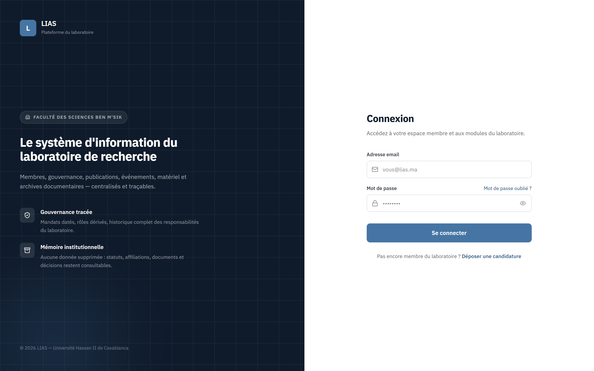

**Figure 6.1** — Interface d'authentification


Le jeton reçu est conservé côté navigateur et réinjecté par l'intercepteur de requête sur
chaque appel. L'écran donne également accès au parcours de réinitialisation du mot de
passe.


## Tableau de bord


Le tableau de bord (figure 6.2) est la page d'entrée de l'espace interne.
Son contenu est adapté au rôle : les indicateurs de demandes d'adhésion et les blocs de
pilotage ne sont chargés que pour les profils de direction, ce qui évite d'émettre des
requêtes vouées à un refus.


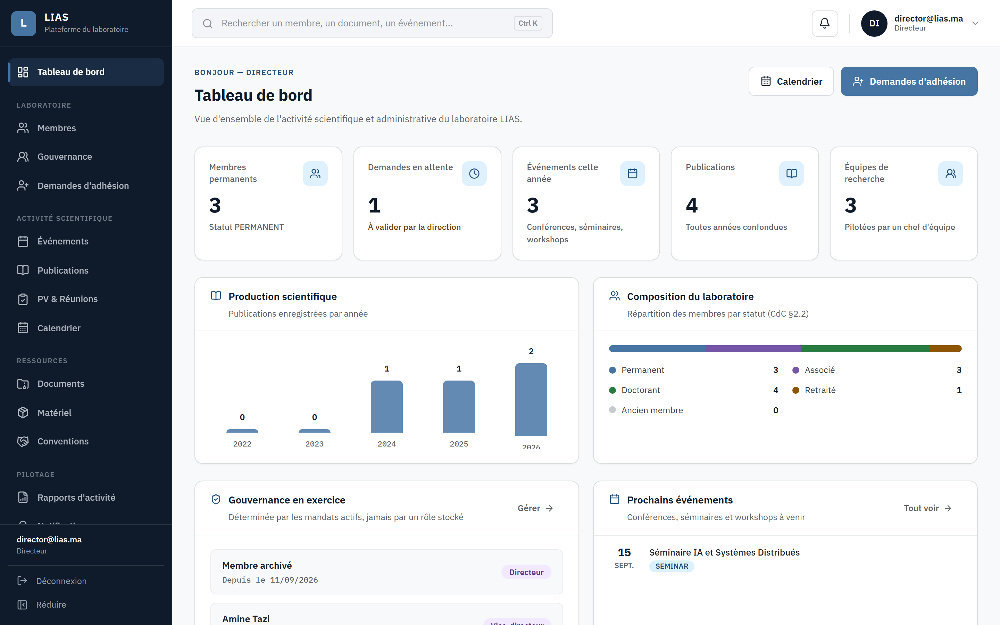

**Figure 6.2** — Tableau de bord principal du système LIAS


On y distingue la barre de navigation latérale, groupée par domaine — laboratoire,
activité scientifique, ressources, pilotage — et la barre supérieure portant la recherche
globale et le compteur de notifications non lues.


## Gestion des membres


La liste des membres (figure 6.3) propose une recherche temporisée, un
filtrage par statut et des indicateurs de répartition. Le statut est rendu par un badge de
couleur distincte, conformément à l'exigence de lisibilité de la séparation entre statut et
rôle.


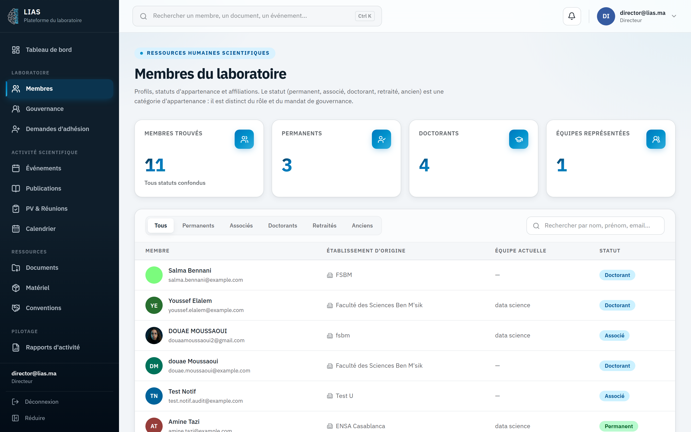

**Figure 6.3** — Liste des membres du laboratoire avec filtrage par statut


La sélection d'une ligne ouvre la fiche du membre, organisée en quatre onglets. L'onglet
*Gouvernance* (figure 6.4) est celui qui matérialise la règle
centrale du projet.


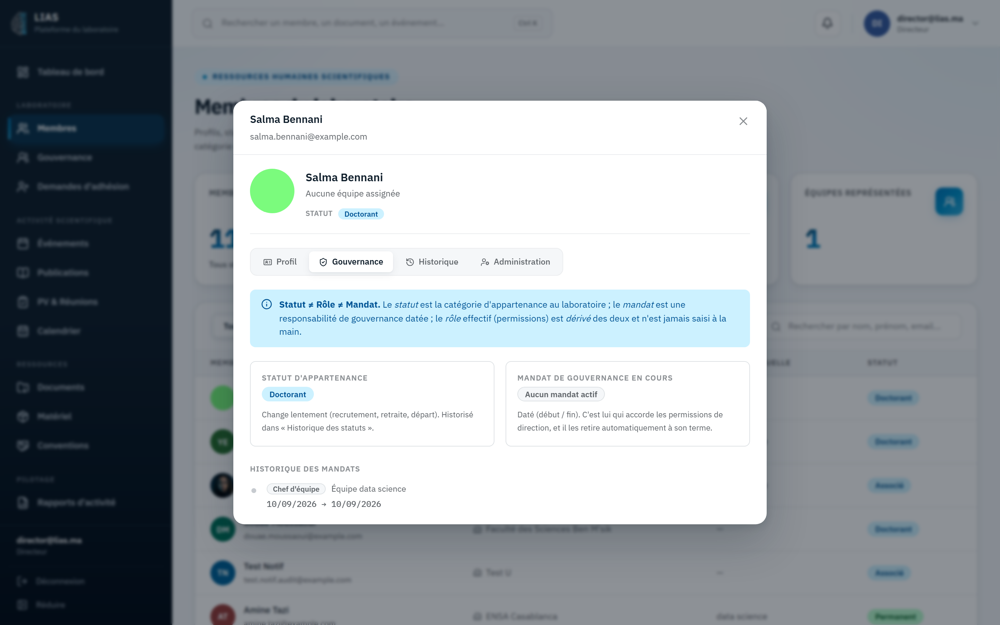

**Figure 6.4** — Fiche membre — onglet Gouvernance, matérialisant la séparation STATUT / RÔLE / MANDAT


Cet écran présente côte à côte le statut d'appartenance et le mandat de gouvernance en
cours, accompagnés d'un encadré explicitant que le rôle effectif est *dérivé* des deux
et n'est jamais saisi. Sur la capture, le membre est doctorante, ne détient aucun mandat
actif, et l'historique conserve néanmoins un mandat de chef d'équipe échu : la séparation
des trois notions est directement lisible à l'écran, ce qui était l'un des objectifs
d'interface du cahier des charges.

L'onglet *Historique* (figure 6.5) présente en vis-à-vis les deux
chronologies exigées par la section 4 du cahier des charges : l'historique des statuts et
les périodes d'affiliation.


**Figure 6.5** — Fiche membre — historique des statuts et périodes d'affiliation


La mention portée sous la seconde colonne — un membre peut quitter puis revenir, chaque
période étant conservée séparément — rappelle la règle §4.3 dont cet écran est la
traduction visuelle.


## Gouvernance


Le module de gouvernance est organisé en trois onglets. L'onglet *Structure*
(figure 6.6) affiche l'organigramme de direction, entièrement déduit des
mandats actifs : un poste sans titulaire est explicitement présenté comme vacant plutôt que
masqué.


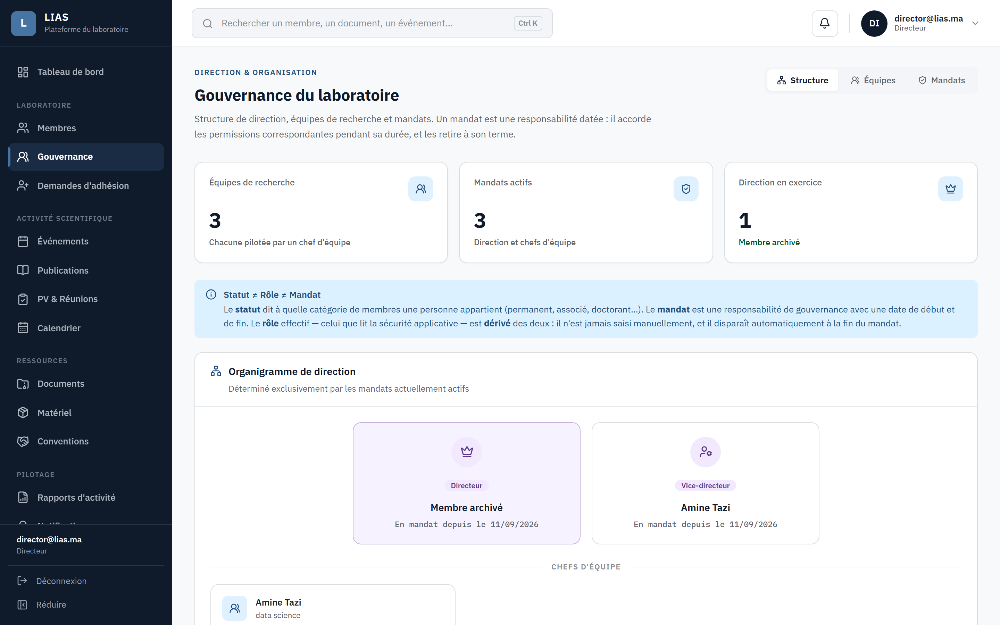

**Figure 6.6** — Gouvernance — organigramme de direction déduit des mandats actifs


L'onglet *Mandats* (figure 6.7) permet l'attribution et la clôture
des responsabilités. Le formulaire avertit que l'attribution d'un mandat de directeur ou de
vice-directeur clôt automatiquement celui du titulaire précédent, et la note de bas de
tableau rappelle qu'une clôture ne supprime rien.


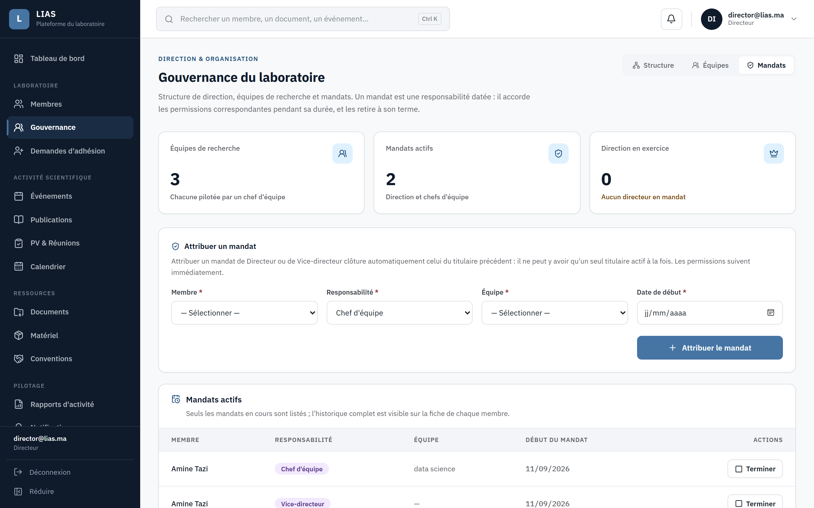

**Figure 6.7** — Gouvernance — attribution et clôture des mandats


Ces commandes ne sont affichées qu'à l'administrateur système et au directeur. Un
vice-directeur accédant à la même page obtient la consultation et un encart explicatif —
correction issue de l'audit, décrite au chapitre 8.


## Équipes


L'onglet *Équipes* (figure 6.8) présente les équipes de recherche
avec leur responsable, leur effectif et leur date de création, ainsi que le formulaire de
transfert d'un membre d'une équipe à une autre.


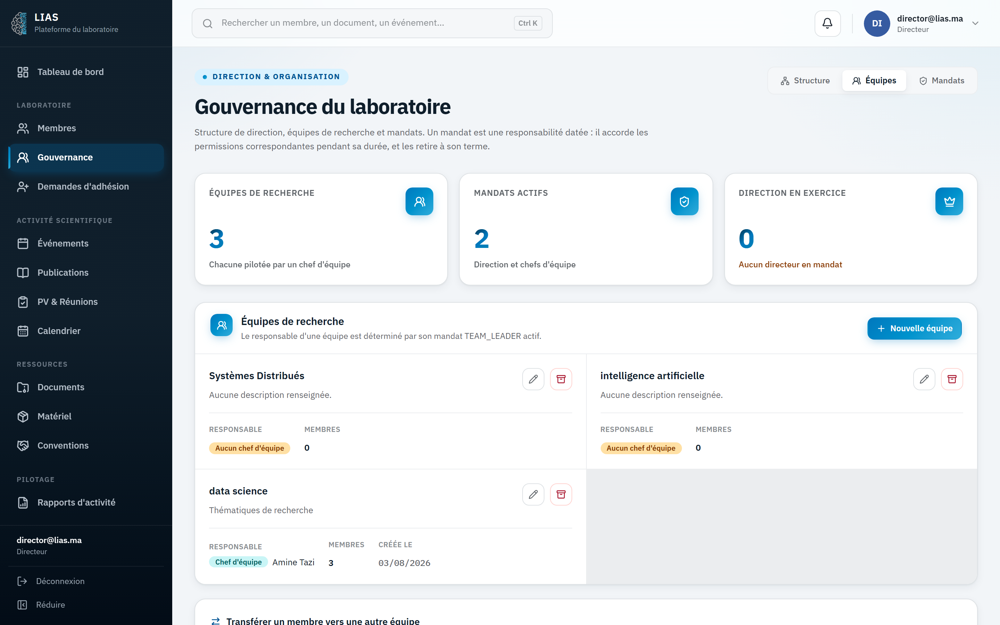

**Figure 6.8** — Gouvernance — équipes de recherche et transfert de membre


Le responsable affiché n'est pas un champ saisi : il provient du mandat de chef d'équipe
actif rattaché à l'équipe. Une équipe sans mandat actif porte la mention « Aucun chef
d'équipe ».


## Demandes d'adhésion


L'écran des candidatures (figure 6.9) liste les dossiers déposés depuis le
portail public, avec leur état et le détail de chaque dossier.


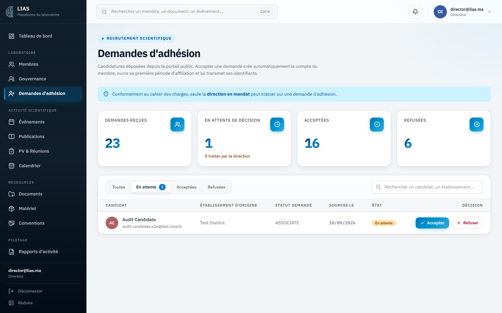

**Figure 6.9** — Demandes d'adhésion déposées depuis le portail public


Conformément à la section 6 du cahier des charges, les boutons de décision ne sont rendus
que pour le directeur en mandat ; l'administrateur système et le vice-directeur accèdent à
la consultation, accompagnée d'un message explicite. L'acceptation crée le compte du
membre, ouvre sa première période d'affiliation et lui transmet ses identifiants.


## Équipements


Le module matériel (figure 6.10) est organisé en deux onglets : l'inventaire et
les demandes. Les indicateurs de tête distinguent les références en stock, les unités
disponibles, les unités distribuées et les références épuisées.


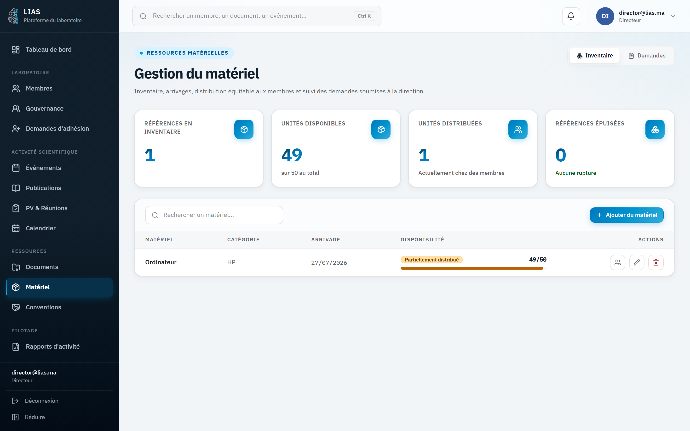

**Figure 6.10** — Gestion du matériel — inventaire et indicateurs de stock


Le registre de distribution (figure 6.11) répond à l'exigence la plus
spécifique de la section 14 : il présente non seulement les bénéficiaires d'un article,
mais également les membres actifs qui ne l'ont pas reçu, information calculée côté serveur.


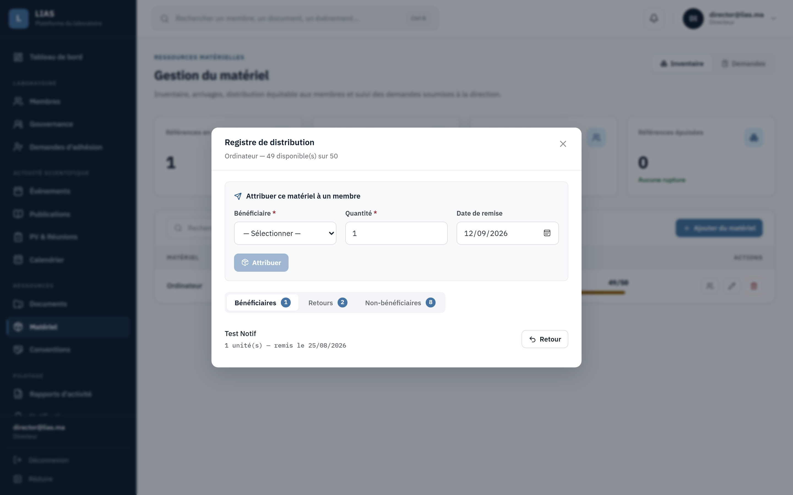

**Figure 6.11** — Registre de distribution — bénéficiaires et non-bénéficiaires d'un article


## Documents


L'archivage documentaire (figure 6.12) propose la recherche, le filtrage par
catégorie, le dépôt et le téléchargement, avec des indicateurs de volume stocké et de
documents versionnés.


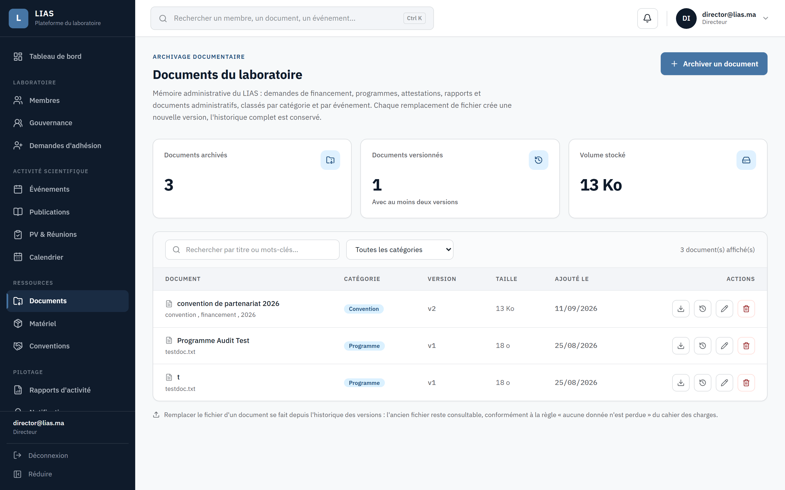

**Figure 6.12** — Archivage documentaire du laboratoire


L'historique des versions (figure 6.13) matérialise l'exigence
d'historisation : chaque dépôt successif est conservé avec son numéro, son auteur et sa
date, et reste téléchargeable individuellement.


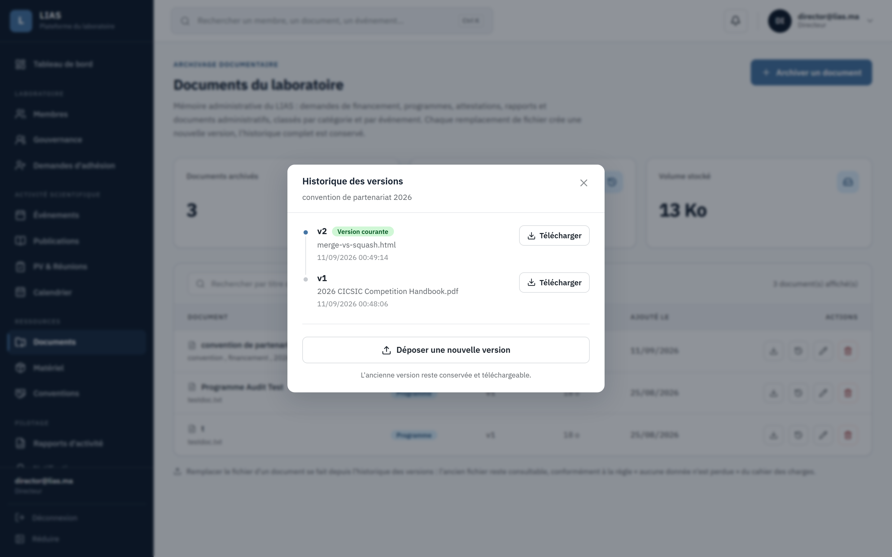

**Figure 6.13** — Historique des versions d'un document archivé


Les téléchargements ne sont pas de simples liens : les fichiers étant hors de l'espace
public, ils sont récupérés par requête authentifiée puis remis au navigateur, ce qui
garantit que le contrôle d'accès s'applique aussi aux pièces jointes.


## Événements et calendrier


L'écran des événements (figure 6.14) couvre les conférences, séminaires et
workshops, avec la gestion des organisateurs et des inscriptions.


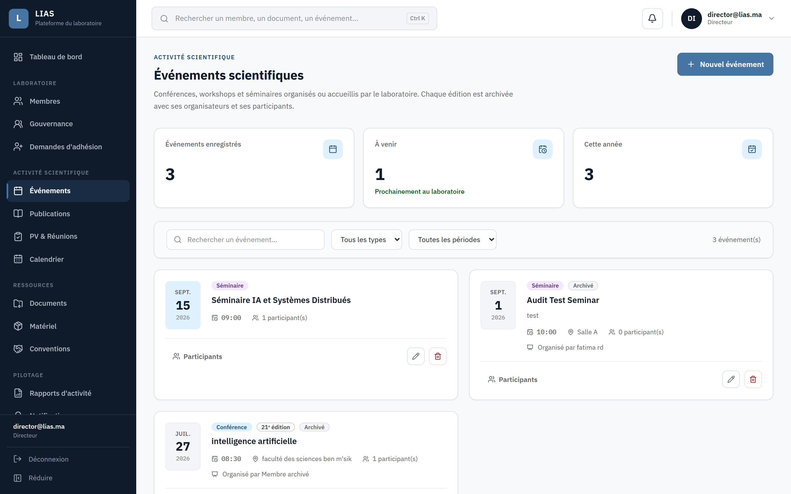

**Figure 6.14** — Événements scientifiques du laboratoire


Le calendrier (figure 6.15) agrège en une vue unique les événements
scientifiques et les réunions internes, avec navigation mensuelle et panneau de détail du
jour sélectionné.


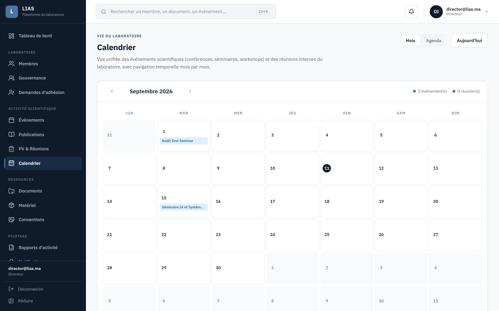

**Figure 6.15** — Calendrier unifié des événements et des réunions


Cette agrégation est réalisée côté serveur par `CalendarService`, qui fusionne deux
sources hétérogènes en une liste ordonnée d'éléments typés.


## Publications et procès-verbaux


Le répertoire des publications (figure 6.16) permet la recherche et le
classement par année, équipe et auteur, conformément à la section 12. Son ajout est ouvert
aux doctorants comme aux membres.


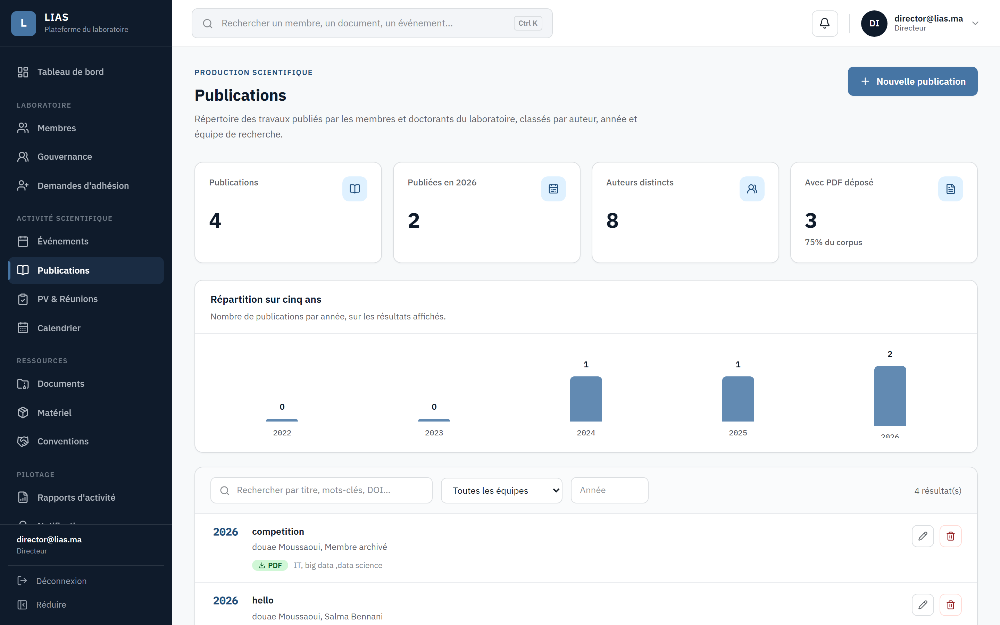

**Figure 6.16** — Répertoire des publications scientifiques


Le module des réunions (figure 6.17) couvre la planification, l'ordre du jour
et le dépôt des procès-verbaux exigés par la section 17.


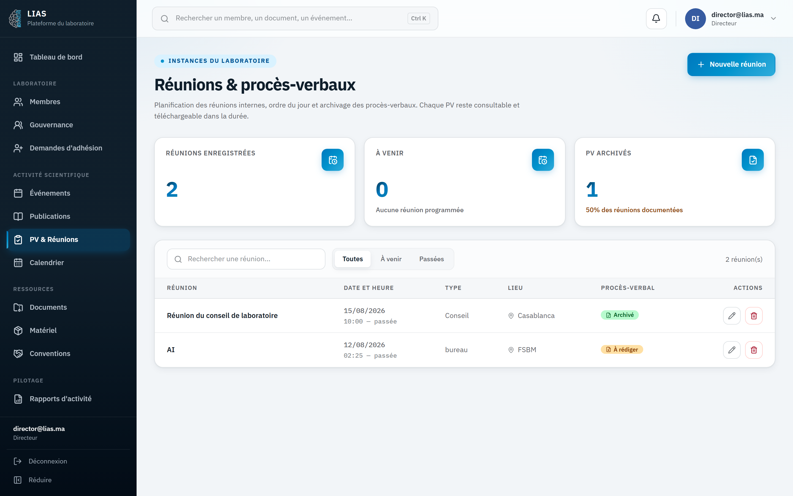

**Figure 6.17** — Réunions internes et archivage des procès-verbaux


Le module des conventions (figure 6.18) gère les partenaires académiques
et industriels ainsi que les conventions associées et leurs documents.


**Figure 6.18** — Conventions et partenariats — le jeu de démonstration ne comporte qu'un partenaire,
sans convention signée à ce jour


L'état de cette capture est celui du jeu de données de démonstration : un seul partenaire y
est enregistré et aucune convention ne lui est encore rattachée. Les compteurs à zéro
traduisent donc un module opérationnel mais peu alimenté, et non un défaut de chargement.


## Notifications


L'espace de communication interne (figure 6.19) réunit le centre de
notifications personnel et les discussions, déclinées selon les trois portées prévues par
la section 13 : laboratoire, équipe et événement.


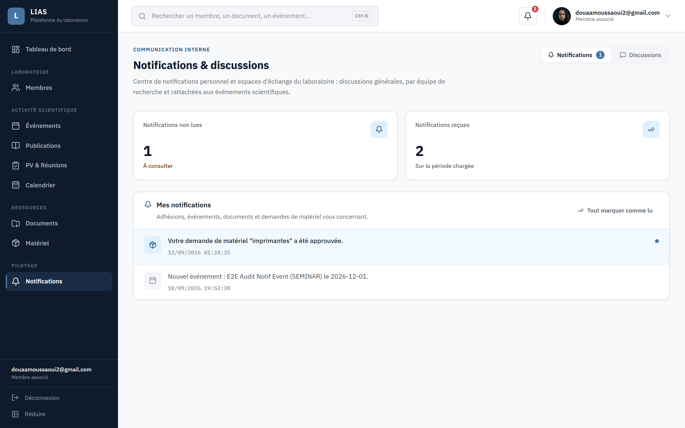

**Figure 6.19** — Notifications personnelles et espaces de discussion


Un compte technique dépourvu de profil de membre — l'administrateur système — ne
possède pas de boîte de réception ; l'interface le détecte et affiche un état vide explicite
plutôt qu'une erreur.


## Audit et rapport annuel


Le journal d'audit (figure 6.20) restitue la trace intégrale des actions
sensibles : acteur, action, entité concernée, adresse IP et horodatage.


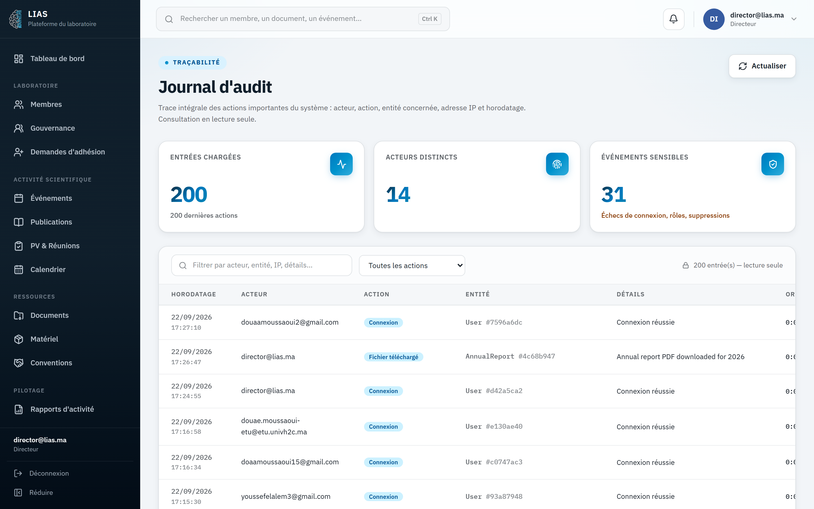

**Figure 6.20** — Journal d'audit — traçabilité des actions du système


L'écran des rapports d'activité (figure 6.21) permet de générer la synthèse
d'une année et d'en télécharger la version PDF.


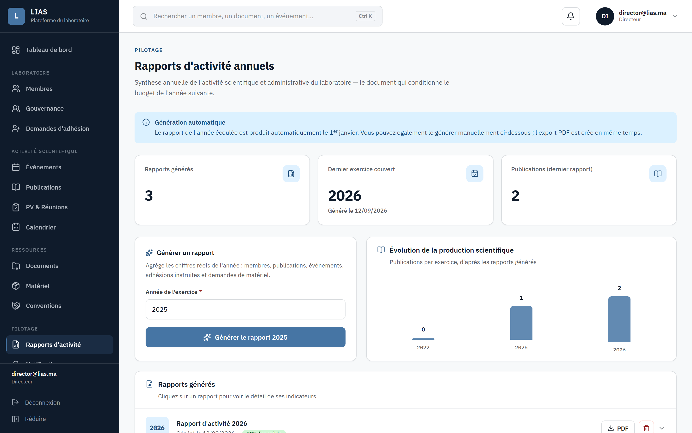

**Figure 6.21** — Rapports d'activité annuels et export PDF


L'administration système (figure 6.22) regroupe la gestion des comptes, des
rôles techniques et de l'identité institutionnelle. L'avertissement porté en bas d'écran
rappelle qu'une modification manuelle de rôle constitue une dérogation administrative,
historisée au même titre qu'un changement issu d'un mandat.


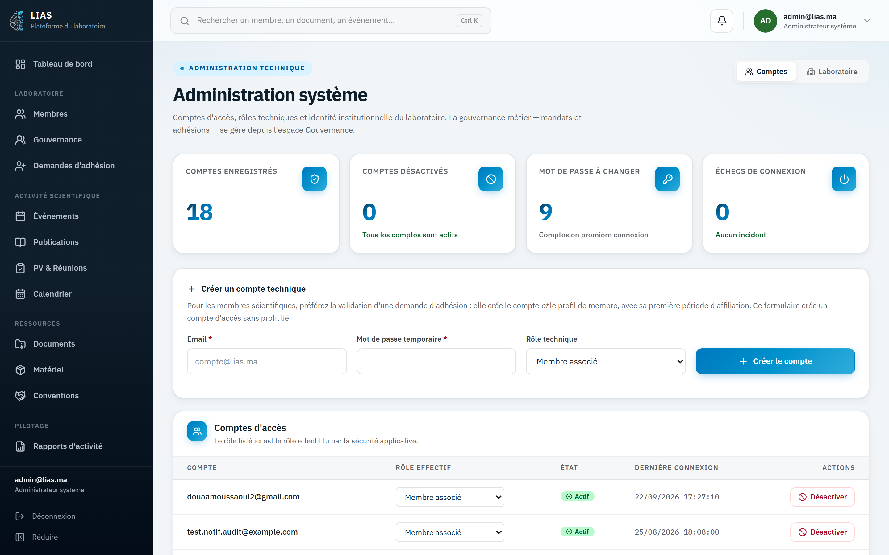

**Figure 6.22** — Administration système — comptes, rôles et identité du laboratoire


## Portail public


Le portail public (figure 6.23) constitue la vitrine institutionnelle. Il
présente le laboratoire, ses indicateurs, ses publications récentes, ses équipes et ses
événements, sans exiger d'authentification.


**Figure 6.23** — Portail public du laboratoire LIAS


Ses données proviennent des mêmes tables que l'espace interne, via des endpoints
explicitement ouverts. Le formulaire de candidature (figure 6.24) permet le
dépôt d'un dossier avec lettre de motivation et curriculum vitæ, alimentant directement le
module de demandes d'adhésion.


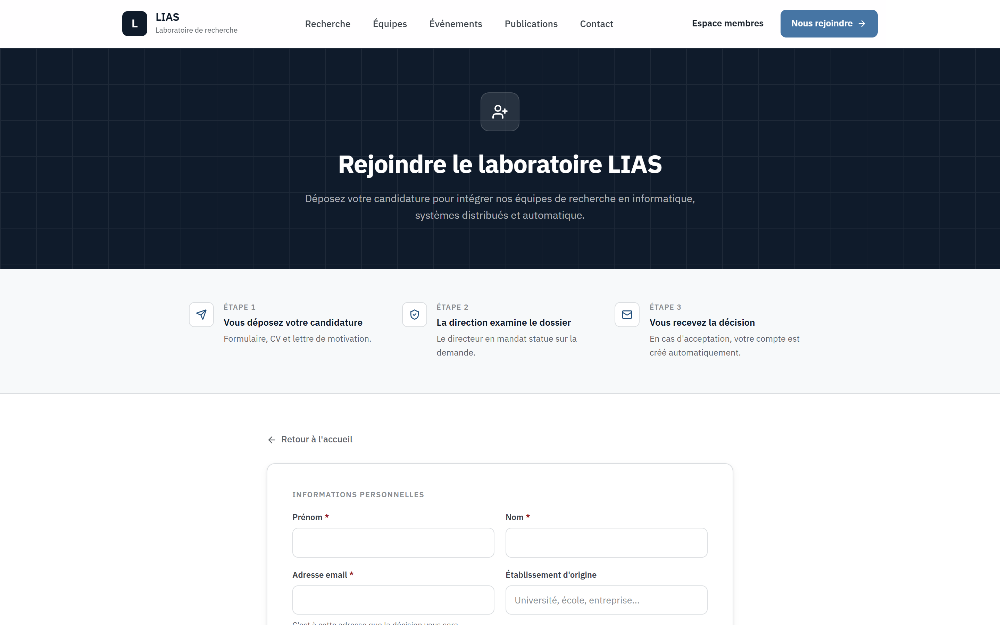

**Figure 6.24** — Formulaire public de candidature au laboratoire


## Design responsive et navigation


La mise en page repose sur les grilles et utilitaires de Tailwind. Sous 1024 pixels, la
barre latérale bascule en tiroir superposé avec voile de fond ; les grilles d'indicateurs
passent de quatre à deux puis à une colonne ; les tableaux larges défilent horizontalement
dans leur propre conteneur, de sorte que la page elle-même ne défile jamais latéralement.

La navigation latérale est générée à partir d'une description déclarative associant à
chaque entrée la liste des rôles autorisés, identique à celle qu'applique le garde de
route. Un module inaccessible n'est donc pas affiché puis refusé : il est absent de la
navigation. Cette propriété est illustrée au chapitre suivant
(figure 7.1).


# Sécurité, autorisation et traçabilité


## Authentification JWT


L'authentification repose sur des jetons JSON Web Token signés en HMAC-SHA-512. À la
connexion, le serveur émet un jeton d'accès valable une heure et un jeton de
rafraîchissement valable sept jours. Le jeton d'accès porte l'identifiant du compte, son
adresse électronique, son type et son rôle.

Les mots de passe ne sont jamais stockés en clair : ils sont hachés par BCrypt avec un
facteur de coût de 12, soit $2^{12}$ itérations. Ce paramètre rend une attaque par
dictionnaire coûteuse tout en gardant une vérification de l'ordre de quelques centaines de
millisecondes, acceptable pour une opération de connexion.

Le mécanisme comporte un choix de conception qui mérite d'être explicité, car il va à
l'encontre de l'usage le plus répandu.


**Le rôle inscrit dans le jeton n'est pas utilisé pour autoriser.**  À chaque
requête, `JwtAuthenticationFilter` vérifie la signature, puis recharge l'utilisateur
depuis la base de données et reconstruit ses habilitations à partir de l'état courant. Le
rôle présent dans la charge utile n'est conservé qu'à titre informatif pour le client.

Ce choix a un coût — une lecture supplémentaire par requête — et un bénéfice
déterminant : un jeton ne peut pas survivre à la révocation des droits qu'il transporte. Un
membre mis à la retraite pendant la durée de vie de son jeton voit son accès refusé à la
requête suivante, sans qu'il soit nécessaire de tenir une liste de jetons révoqués.


## Autorisation RBAC


Le contrôle d'accès est fondé sur les rôles et s'applique à deux niveaux complémentaires.

Le premier niveau, déclaré dans `SecurityConfig`, distingue les ressources publiques
des ressources protégées : les endpoints d'authentification, le préfixe `/public/**`,
la documentation de l'API et les lectures des publications, événements, équipes et
partenaires sont ouverts ; tout le reste exige une authentification.

Le second niveau, activé par `@EnableMethodSecurity`, place une annotation
`@PreAuthorize` sur chaque méthode ou classe de contrôleur. La règle est ainsi lisible
à côté du code qu'elle protège. Ce niveau produit la matrice détaillée à la section
suivante.

Un troisième cas, plus rare, relève du service et non de l'annotation : lorsque
l'autorisation dépend de l'identité de la cible et pas seulement du rôle de l'appelant. La
modification d'un profil en est l'exemple — un membre peut modifier le sien, la direction
peut modifier celui d'un autre — et la vérification est portée par
`MemberService`.


## Matrice des permissions


Le tableau 7.1 présente la matrice complète, relevée des annotations du code
et vérifiée par appels réels sur l'application en fonctionnement.


**Tableau 7.1** — Matrice des permissions par rôle applicatif (● = autorisé)

| **Opération** | {0}{**ADMIN**} | **DIR** | **V-DIR** | **CHEF** | **PERM** | **ASSO** | **DOCT** |
| --- | --- | --- | --- | --- | --- | --- | --- |
| {8}{@{}l}{ Consultation générale} |  |  |  |  |  |  |  |
| Portail public, publications, événements, équipes | ● | ● | ● | ● | ● | ● | ● |
| Liste et fiches des membres | ● | ● | ● | ● | ● | ● | ● |
| Calendrier, notifications, discussions, recherche | ● | ● | ● | ● | ● | ● | ● |
| Modifier son propre profil | ● | ● | ● | ● | ● | ● | ● |
| {8}{@{}l}{ Activité scientifique} |  |  |  |  |  |  |  |
| Ajouter / modifier une publication | ● | ● | ● | ● | ● | ● | ● |
| Supprimer une publication | ● | ● | ● |  |  |  |  |
| Créer / modifier un événement ou une réunion | ● | ● | ● | ● |  |  |  |
| Déposer un procès-verbal | ● | ● | ● | ● |  |  |  |
| Supprimer un événement, une réunion | ● | ● | ● |  |  |  |  |
| S'inscrire à un événement | ● | ● | ● | ● | ● | ● | ● |
| {8}{@{}l}{ Modules internes (fermés aux doctorants — CdC §2.2.C)} |  |  |  |  |  |  |  |
| Consulter documents, matériel, procès-verbaux | ● | ● | ● | ● | ● | ● |  |
| Déposer un document, créer une version | ● | ● | ● | ● | ● | ● |  |
| Supprimer un document | ● | ● | ● |  |  |  |  |
| Soumettre une demande de matériel | ● | ● | ● | ● | ● | ● |  |
| {8}{@{}l}{ Gestion des ressources} |  |  |  |  |  |  |  |
| Gérer l'inventaire, distribuer, enregistrer un retour | ● | ● | ● |  |  |  |  |
| Valider ou rejeter une demande de matériel |  | ● | ● |  |  |  |  |
| Gérer partenaires et conventions | ● | ● | ● |  |  |  |  |
| {8}{@{}l}{ Gouvernance et membres} |  |  |  |  |  |  |  |
| Modifier le profil d'un autre membre | ● | ● | ● |  |  |  |  |
| Changer le statut d'un membre | ● | ● | ● |  |  |  |  |
| Transférer un membre entre équipes | ● | ● | ● |  |  |  |  |
| Archiver / restaurer un membre, départ, retour | ● | ● |  |  |  |  |  |
| Créer, modifier, archiver une équipe | ● | ● |  |  |  |  |  |
| Attribuer ou clôturer un mandat | ● | ● |  |  |  |  |  |
| Consulter les demandes d'adhésion | ● | ● | ● |  |  |  |  |
| **Statuer sur une demande d'adhésion** |  | ● |  |  |  |  |  |
| {8}{@{}l}{ Pilotage et administration} |  |  |  |  |  |  |  |
| Générer et télécharger le rapport annuel | ● | ● | ● |  |  |  |  |
| Consulter le journal d'audit | ● | ● | ● |  |  |  |  |
| Gérer les comptes et les rôles techniques | ● |  |  |  |  |  |  |
| Modifier l'identité du laboratoire | ● |  |  |  |  |  |  |


Trois asymétries de cette matrice ne sont pas des erreurs mais des traductions littérales
du cahier des charges.

La décision sur une demande d'adhésion appartient au seul directeur (§6 : « uniquement par
le directeur en mandat »). L'administrateur système, pourtant le plus privilégié
techniquement, n'y a pas accès : c'est une décision institutionnelle, non technique.

Symétriquement, la validation d'une demande de matériel appartient au directeur et au
vice-directeur, mais pas à l'administrateur système, pour la même raison.

Enfin, l'administrateur système ne gère pas les équipes ni les mandats au même titre que le
directeur — il les partage avec lui — mais il est seul à pouvoir créer un compte ou
modifier l'identité du laboratoire.

La figure 7.1 illustre l'effet de cette matrice sur l'interface : la
navigation d'un doctorant ne comporte que les six modules qui lui sont ouverts. Les
modules internes ne sont pas grisés, ils sont absents.


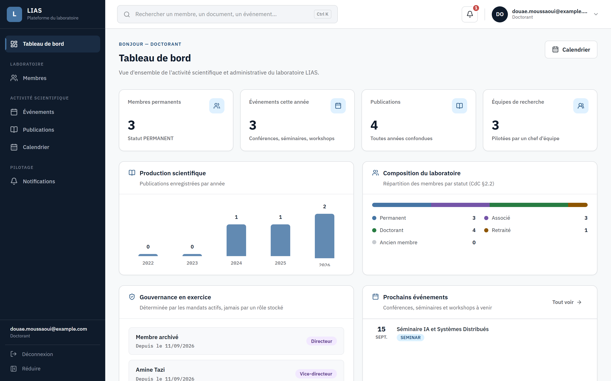

**Figure 7.1** — Navigation réduite d'un compte doctorant — les modules internes sont absents


## Gestion des statuts


Les cinq statuts d'appartenance sont portés par l'énumération `MemberStatus`. Un
changement de statut est toujours historisé dans `MemberStatusHistory` avec sa date
d'effet et son motif, et déclenche systématiquement la resynchronisation du rôle.

Deux statuts produisent un effet de bord sur la sécurité : le passage à
`RETIRED` ou `FORMER` clôt les mandats en cours en plus de geler le compte. Cette
clôture explicite garantit que l'historique de gouvernance reste cohérent — on ne trouve
pas de mandat ouvert détenu par un membre parti.


## Synchronisation rôle / mandat


Le mécanisme a été décrit en §5.5 et illustré par la figure 3.6.
Du point de vue de la sécurité, sa propriété essentielle est la suivante : il n'existe
aucun chemin par lequel un rôle de gouvernance puisse être obtenu sans mandat
correspondant, à l'exception de la dérogation administrative explicite
(`ADMIN_OVERRIDE`), elle-même historisée et signalée dans l'interface.

La réconciliation exécutée au démarrage constitue un filet de sécurité supplémentaire.
Elle garantit qu'un compte dont le rôle aurait dérivé — par import, par intervention
directe en base ou par antériorité — est ramené à la valeur que son statut et ses mandats
impliquent, avec une trace portant la cause `RECONCILIATION`. Sur le système en
exploitation, cette procédure ne corrige plus rien et signale simplement que tous les
comptes sont conformes.


## Protection des comptes retraités et anciens


Le gel repose sur une seule expression, évaluée à la construction des détails
d'authentification :


*Règle de gel des comptes ({CustomUserDetails*

```java
// Un membre RETIRED ou FORMER est gele, quelle que soit la valeur brute
// de users.enabled (CdC section 8 : "compte gele" / "compte desactive").
this.enabled = user.isEnabled() && !isFrozenStatus(memberStatus);
```


Cette expression est évaluée à chaque requête, puisque les détails sont reconstruits à
chaque passage du filtre. Un compte gelé ne peut donc ni se connecter ni continuer à
utiliser un jeton déjà émis. Son historique demeure en revanche intégralement consultable
par la direction, conformément à la section 8 du cahier des charges.

Un compte technique dépourvu de profil de membre — l'administrateur système — n'est pas
concerné par ce gel : l'absence de statut n'est pas assimilée à un statut gelé.


## Journal d'audit


Toute action sensible est consignée : création, modification, suppression, restauration,
approbation, rejet, connexion, échec de connexion, déconnexion, réinitialisation de mot de
passe, changement de rôle, changement de statut, dépôt et téléchargement de fichier.

Chaque entrée conserve l'identité de l'acteur, son adresse électronique, l'action, le type
et l'identifiant de l'entité concernée, un libellé, l'adresse IP et l'horodatage. L'usage
de la propagation `REQUIRES_NEW` garantit que la trace subsiste même si l'opération
auditée est annulée.

Le journal est consultable par l'administrateur système et la direction, avec filtrage par
entité et par acteur.


## Gestion des secrets


Aucune donnée d'authentification ne figure dans le code source suivi en gestion de version.
Les paramètres de connexion à la base, les identifiants de messagerie, la clé de signature
des jetons et le répertoire de stockage sont lus depuis des variables d'environnement. Un
fichier local, exclu du dépôt, les fournit en développement ; un fichier d'exemple ne
contenant que des valeurs fictives documente les clés attendues.

Cette externalisation a été mise en place en fin de projet, après le constat que des
identifiants de base de données figuraient dans un fichier de configuration versionné. La
remédiation a comporté deux volets : la suppression des valeurs du code suivi, et la
rotation effective du mot de passe concerné — vérifiée par test de connexion : le nouvel
identifiant est accepté, l'ancien est rejeté. L'historique de gestion de version conserve
encore l'ancienne valeur, désormais sans effet ; la procédure de purge est documentée dans
le dépôt et reste à la discrétion du propriétaire.

Cet épisode constitue un enseignement méthodologique du projet : une configuration de
développement est un fichier de code comme un autre, et doit être traitée comme tel dès le
premier commit.


# Tests et validation


## Stratégie de test


La stratégie retenue n'a pas visé une couverture maximale du code mais la protection des
règles métier dont une régression serait à la fois plausible et grave. Trois critères ont
guidé la sélection : la règle est-elle une exigence explicite du cahier des charges ?
Une erreur y serait-elle silencieuse ? Le code correspondant est-il susceptible d'évoluer ?

Cinq domaines satisfont ces trois critères et concentrent l'effort de test : la dérivation
du rôle effectif, le gel des comptes, l'arithmétique du stock de matériel, le ciblage des
notifications, et la matrice d'autorisation.

Deux niveaux de test coexistent. Les tests unitaires isolent un service au moyen de doubles
(Mockito) et s'exécutent sans contexte applicatif ni base de données ; ils sont rapides et
déterministes. Les tests d'intégration démarrent le contexte Spring complet sur une base
H2 en mémoire, avec le schéma dérivé des entités et les migrations désactivées ; ils
valident la chaîne de sécurité réelle. Ces derniers sont configurés pour ne jamais atteindre
la base de production : l'import du fichier de configuration local est explicitement
neutralisé dans le profil de test.

Le tableau 8.1 récapitule les suites.


**Tableau 8.1** — Suites de tests automatisés

| **Classe de test** | **Tests** | **Nature** | **Objet** |
| --- | --- | --- | --- |
| `UserRoleSyncServiceTest` | 17 | Unitaire | Dérivation STATUT / RÔLE / MANDAT, réconciliation |
| `AuthorizationMatrixTest` | 9 | Intégration | Matrice d'autorisation des 9 rôles |
| `EquipmentServiceTest` | 8 | Unitaire | Invariant de stock du matériel |
| `NotificationServiceTest` | 5 | Unitaire | Ciblage des destinataires |
| `CustomUserDetailsTest` | 5 | Unitaire | Gel des comptes retraités et anciens |
| `BadRequestParamTest` | 4 | Intégration | Validation des paramètres de requête |
| **Total** | **48** |  |  |


## Tests unitaires de la dérivation des rôles


C'est la suite la plus fournie, parce que la règle qu'elle protège est la plus structurante
du projet. Elle vérifie successivement :


- la correspondance entre chacun des cinq statuts et son rôle dérivé, en l'absence de
 mandat ;
- la promotion par mandat, pour les trois types de mandats ;
- la priorité stricte entre mandats cumulés : un membre détenant simultanément un
 mandat de chef d'équipe et un mandat de directeur obtient le rôle de directeur ;
- la primauté du statut gelé : un membre retraité conservant par anomalie un mandat
 de directeur actif obtient malgré tout le rôle de retraité ;
- l'écriture systématique d'une ligne d'historique portant la cause du changement ;
- l'absence d'écriture lorsque le rôle calculé est déjà celui enregistré ;
- la correction d'une dérive par `reconcileAll()`, son **idempotence**
 — une seconde exécution sur un système cohérent n'écrit rien — et le
 complètement des historiques manquants.


Le test d'idempotence mérite d'être souligné : il garantit que la procédure de
réconciliation exécutée à chaque démarrage ne pollue pas l'historique en y ajoutant une
ligne à chaque redémarrage.


## Tests d'intégration


Les deux suites d'intégration démarrent le contexte complet. Elles vérifient donc, au-delà
de la logique métier, que la configuration de sécurité, la chaîne de filtres, la
sérialisation JSON et le gestionnaire d'exceptions fonctionnent ensemble.

L'exécution de ces suites a d'ailleurs révélé un défaut qu'aucun test unitaire n'aurait
détecté, décrit en §8.10.1.


## Tests d'autorisation


`AuthorizationMatrixTest` vérifie la matrice du
tableau 7.1 selon trois assertions systématiques par endpoint :


1. une requête anonyme sur une ressource protégée reçoit un code 401 ;
2. une requête portant un rôle insuffisant reçoit un code 403 ;
3. une requête portant un rôle autorisé n'est jamais rejetée par 401 ni 403.


La troisième assertion est volontairement formulée en négatif. Un rôle autorisé peut
légitimement recevoir un 404 — l'entité visée n'existe pas dans la base de test — ou un
400 ; ce qui importe est qu'il ne soit pas *refusé*. Formuler l'assertion ainsi évite
de faire dépendre un test d'autorisation de la présence d'un jeu de données.

Les neuf tests couvrent les endpoints publics, une ressource ouverte à tout compte
authentifié, l'administration réservée à l'administrateur système, le journal d'audit et
les rapports réservés à la direction, les suppressions de niveau gouvernance, la fermeture
des modules internes aux doctorants, et l'accès explicite des doctorants à la création de
publications — une autorisation qui pourrait sembler une erreur et qui est bien une
exigence du cahier des charges.


## Tests de validation des paramètres


`BadRequestParamTest` verrouille une correction issue de l'audit : un paramètre de
requête absent ou inconvertible doit produire un code 400 et non un code 500. Les quatre
cas couverts sont un paramètre obligatoire manquant, une valeur d'énumération inconnue, un
identifiant UUID mal formé et un paramètre numérique non numérique.


## Tests du cycle de vie des membres


Le gel des comptes est vérifié par `CustomUserDetailsTest` : un membre retraité ou
ancien n'est pas actif quelle que soit la valeur brute du champ correspondant en base ; un
compte technique dépourvu de profil de membre reste utilisable ; un compte
administrativement désactivé reste inactif indépendamment de son statut. La cohérence des
transitions elles-mêmes — départ, retour, nouvelle période d'affiliation — a été
validée par l'audit fonctionnel décrit en §8.10.


## Tests des équipements


`EquipmentServiceTest` vérifie l'invariant de stock sous huit angles, dont trois
méritent d'être cités : la distribution de l'intégralité du stock restant est autorisée et
amène la disponibilité à zéro ; une distribution excédant le stock est refusée {sans
modifier l'état} ; un cycle complet de distribution puis de retour laisse le stock
exactement dans son état initial. Les deux derniers tests portent sur le rééquilibrage de
la disponibilité lors d'un changement de quantité totale, y compris le cas limite où la
diminution devrait produire une valeur négative — le résultat est alors ramené à zéro.


## Tests des notifications


`NotificationServiceTest` valide le ciblage. Le test le plus significatif vérifie que
la notification de la gouvernance atteint le directeur et le vice-directeur
*actuellement en mandat*, destinataires résolus dynamiquement et non lus dans un champ
de rôle. Les autres cas couvrent la persistance d'une notification non lue, l'ignorance
silencieuse d'un destinataire inconnu, l'absence d'envoi lorsqu'aucun mandat n'est pourvu,
et la déduplication d'une liste de destinataires.


## Résultats des 48 tests


L'exécution complète, sur le commit final, donne le résultat reproduit
au tableau 8.2.


**Tableau 8.2** — Résultats d'exécution de la suite de tests

| **Commande** | **Résultat** | **Détail** |
| --- | --- | --- |
| `mvn clean test` | **BUILD SUCCESS** | 48 tests exécutés, 0 échec, 0 erreur, 0 ignoré |
| `mvn clean compile` | **BUILD SUCCESS** | Compilation du backend sans avertissement bloquant |
| `npm run build` | **Succès** | 1 919 modules transformés |
| `npx oxlint` | **0 erreur** | 6 avertissements préexistants sur l'export de constantes |


Aucune mesure de couverture de code n'est rapportée : aucun outil de couverture n'a été
configuré sur le projet. Annoncer un pourcentage serait une invention. Ce que l'on peut
affirmer est plus limité et plus vérifiable : les cinq règles métier identifiées comme
critiques disposent chacune d'une suite dédiée, et la matrice d'autorisation est vérifiée
pour l'ensemble des rôles.


## Validation fonctionnelle de bout en bout


Les tests automatisés ont été précédés d'un audit fonctionnel manuel, conduit sur
l'application en fonctionnement. Il a porté sur les 21 routes de l'interface, les 9 rôles,
et 47 endpoints de l'API, chaque page étant parcourue et chaque commande déclenchée.


### Défauts détectés et corrigés


Cet audit a mis au jour quatre défauts réels, tous corrigés et, pour deux d'entre eux,
verrouillés par un test.


**Dérive du rôle sur des comptes antérieurs.**  Des comptes créés avant
l'introduction du service de dérivation conservaient un rôle obsolète, le service n'étant
invoqué que sur les chemins d'écriture. La correction a consisté à ajouter la procédure
`reconcileAll()` exécutée au démarrage, ainsi qu'une migration étendant la contrainte
de la colonne de cause pour admettre la valeur `RECONCILIATION`.


**Commandes visibles mais refusées pour le vice-directeur.**  La page de gouvernance
étant ouverte à trois rôles alors que la gestion des équipes et des mandats n'en autorise
que deux, un vice-directeur voyait des commandes que le serveur lui refusait. Les contrôles
concernés sont désormais masqués pour ce rôle, avec un encart expliquant ce qui lui reste
ouvert. Le test `deleteTeamIsAdminOrDirectorOnly` verrouille la règle côté serveur.


**Paramètre de requête invalide traité en erreur serveur.**  Un paramètre manquant
ou inconvertible aboutissait au gestionnaire d'exception générique et produisait un
code 500 au lieu d'un 400. Des gestionnaires dédiés ont été ajoutés ; la suite
`BadRequestParamTest` verrouille les quatre cas.


**Corps de réponse malformé sur les erreurs d'authentification.**  Défaut découvert
pendant l'écriture des tests d'autorisation, et invisible jusque-là. Les deux gestionnaires
d'erreur de la couche de filtrage sérialisaient leur réponse avec un convertisseur JSON
construit manuellement, dépourvu du module de gestion des dates. La sérialisation de
l'horodatage échouait : le client recevait bien un code 401, mais avec un corps vide, et
une exception était journalisée à chaque requête anonyme. La correction consiste à injecter
le convertisseur configuré par le contexte applicatif. Ce défaut illustre l'intérêt des
tests d'intégration : le code de statut, seul élément observé jusqu'alors, était correct.


### Résultats de la validation


Le tableau 8.3 synthétise les vérifications finales.


**Tableau 8.3** — Résultats de la validation fonctionnelle de bout en bout

| **Vérification** | **Résultat** |
| --- | --- |
| Routes de l'interface parcourues | 21 / 21 rendues, aucun écran vide ni blocage |
| Gardes de route par rôle | Conformes : un doctorant est redirigé depuis les 8 routes qui lui sont fermées |
| Cohérence navigation / autorisation serveur | Conforme : la navigation d'un doctorant se limite à ses 6 modules |
| Dérive de rôle sur les comptes actifs | **0** — le rôle dérivé coïncide avec le rôle stocké pour tous les membres |
| Réconciliation au démarrage | Idempotente : « tous les comptes sont déjà cohérents » |
| Comptes gelés | Authentification refusée (401) pour un statut retraité |
| Requête anonyme sur ressource protégée | 401 avec corps JSON complet |
| Exceptions non gérées côté serveur | 0 sur l'ensemble du parcours |


# Résultats, discussion et perspectives


## Fonctionnalités réalisées


Le système livré comporte dix-huit modules fonctionnels, servis par 22 contrôleurs REST et
21 pages d'interface. Le tableau 9.1 en donne la volumétrie, relevée sur
le commit final.


**Tableau 9.1** — Volumétrie du système livré

| **Backend** |  | **Frontend** |  |
| --- | --- | --- | --- |
| Entités JPA | 31 | Pages React | 21 |
| Services métier | 28 | Composants | 27 |
| Contrôleurs REST | 22 | Modules de design system | 7 |
| Repositories | 30 | Services d'appel API | 19 |
| Énumérations métier | 10 |  |  |
| Migrations Flyway | 3 |  |  |
| Tables relationnelles | 30 |  |  |
| Lignes de Java (sources) | 9 908 | Lignes de JavaScript / JSX | 13 112 |
| Lignes de Java (tests) | 863 | Lignes SQL de migration | 750 |


## Correspondance avec le cahier des charges


Le tableau 9.2 confronte chacune des 21 sections du cahier des charges à
son implémentation. La colonne « preuve » renvoie à la figure du rapport qui en atteste.


**Tableau 9.2** — Correspondance entre le cahier des charges et l'implémentation

| **§** | **Exigence** | **Implémentation** | **Preuve** | **État** |
| --- | --- | --- | --- | --- |
| 1 | Objectifs du système | Architecture trois tiers, 18 modules | Fig. 3.1 | Couvert |
| 2.1 | Accès visiteur libre | Endpoints publics, portail | Fig. 6.23 | Couvert |
| 2.2 | Cinq statuts de membre | `MemberStatus`, badges dédiés | Fig. 6.3 | Couvert |
| 2.2.C | Doctorant sans modules internes | Exclusion au niveau classe | Fig. 7.1 | Couvert |
| 3 | Profil complet et modifiable | `Member`, 11 champs, avatar | Fig. 6.4 | Couvert |
| 4.1 | Date de création du laboratoire | `Laboratory` | Fig. 6.22 | Couvert |
| 4.2 | Dates du membre | 3 champs datés, naissance confidentielle | Fig. 6.5 | Couvert |
| 4.3 | Historique des affiliations | `AffiliationHistory`, retour = nouvelle période | Fig. 6.5 | Couvert |
| 5.1 | Administrateur système | Contrôleur réservé, identité du labo | Fig. 6.22 | Couvert |
| 5.2 | Directeur en mandat | Décisions réservées au directeur | Fig. 6.9 | Couvert |
| 5.3 | Mandats datés, historique conservé | `Mandate`, clôture sans suppression | Fig. 6.7 | Couvert |
| 6 | Demandes d'adhésion | Dépôt public, décision du directeur, création de compte | Fig. 6.24, 6.9 | Couvert |
| 7 | Rôles et responsabilités | `UserRoleSyncService`, rôle dérivé et historisé | Fig. 3.6 | Couvert |
| 8.1 | Retraité : compte gelé | Gel vérifié à chaque requête | Fig. 3.7 | Couvert |
| 8.2 | Ancien membre réactivable | `returnToLab()` | Fig. 3.7 | Couvert |
| 9 | Événements, archivage par édition | `editionNumber`, organisateurs, participants | Fig. 6.14 | Couvert |
| 10 | Archivage documentaire versionné | `DocumentVersion`, 9 catégories | Fig. 6.13 | Couvert |
| 11 | Rapport annuel automatique | Agrégation, PDF, planification annuelle | Fig. 6.21 | Couvert |
| 12 | Publications, doctorants inclus | Classement auteur / année / équipe | Fig. 6.16 | Couvert |
| 13 | Communication interne | 3 portées de discussion | Fig. 6.19 | Couvert |
| 14 | Matériel : reçu / non reçu | Requête de complément dédiée | Fig. 6.11 | Couvert |
| 15 | Besoins en matériel | Soumission, validation par la direction | Fig. 6.10 | Couvert |
| 16 | Conventions et collaborations | `Partner`, `Agreement` | Fig. 6.18 | Couvert |
| 17 | Procès-verbaux | Réunions, ordre du jour, dépôt de PV | Fig. 6.17 | Couvert |
| 18 | Recherche globale | Endpoint transverse, barre permanente | Fig. 6.2 | Couvert |
| 19 | Notifications | 4 politiques de destinataires | Fig. 6.19 | Couvert |
| 20 | Calendrier | Agrégation événements + réunions | Fig. 6.15 | Couvert |
| 21 | Règles générales | Suppression logique, 4 historiques, audit | Fig. 6.20 | Couvert |


Les 21 sections sont couvertes par une fonctionnalité opérationnelle. Cette conformité
porte sur le périmètre fonctionnel ; elle ne signifie pas que le système est exempt de
limites, exposées en §9.4.


## Points forts


**La séparation {** / RÔLE / MANDAT est structurelle, pas déclarative.} Elle
n'est pas seulement documentée : elle est imposée par le code. Le rôle applicatif ne peut
pas être incohérent avec la réalité institutionnelle, parce qu'il en est calculé. La
réconciliation au démarrage garantit en outre que cette propriété reste vraie même si des
données arrivent par un autre chemin.


**La sécurité ne fait pas confiance au jeton.**  Le rechargement systématique des
habilitations depuis la base rend la révocation immédiate. C'est un choix coûteux en
lectures mais qui supprime toute une classe de vulnérabilités liées aux jetons survivants.


**L'interface et le serveur appliquent la même matrice.**  Les listes de rôles
utilisées par les gardes de route et par le masquage des commandes correspondent aux
annotations du serveur. L'audit a permis de corriger le seul écart constaté ; l'objectif
— aucune commande visible qui soit refusée, aucune opération autorisée qui soit masquée
— est atteint.


**Rien n'est jamais détruit.**  La suppression logique généralisée, les quatre tables
d'historique et le journal d'audit répondent ensemble à la règle §21 du cahier des charges.
L'utilitaire de résolution sûre des associations archivées évite que cette conservation ne
dégrade l'expérience.


**La validation ne se limite pas à la compilation.**  Les défauts décrits en
§8.10.1 n'auraient été révélés ni par la compilation, ni par une lecture de
code, ni par la vérification des codes de statut HTTP. Ils l'ont été par un parcours réel
et par des tests d'intégration.


## Limites


Les limites suivantes sont assumées et exposées sans atténuation.


**Absence de thème sombre.**  Le document de spécification le mentionne parmi les
exigences non fonctionnelles. Il n'a pas été implémenté. Le système de composants repose sur
des variables de couleur centralisées, ce qui rendrait l'ajout mécanique, mais le travail
n'a pas été fait.


**Aucune mesure de couverture de code.**  Aucun outil de couverture n'est configuré.
Les 48 tests protègent les règles identifiées comme critiques, mais la proportion du code
exercée n'est pas connue et n'est pas estimée dans ce rapport.


**Modules inégalement couverts par les tests.**  Les discussions, les partenariats et
la génération PDF ne disposent pas de tests automatisés dédiés. Ils ont été validés
manuellement lors de l'audit, ce qui est un niveau de garantie inférieur.


**Pas de campagne de performance.**  Les précautions usuelles sont prises —
pagination côté serveur, désactivation de la session étendue à la vue, index sur les
colonnes de recherche — mais aucune mesure sous charge n'a été conduite. Le comportement
du système au-delà de quelques dizaines d'utilisateurs simultanés n'est pas documenté.


**Accessibilité partielle.**  Les boutons-icônes portent des libellés accessibles, le
focus est visible et les modales se ferment au clavier, mais aucun audit selon un référentiel
formel n'a été mené.


**Rafraîchissement de session non automatisé.**  L'expiration du jeton d'accès ramène
l'utilisateur à l'écran de connexion ; le jeton de rafraîchissement existe et l'endpoint
correspondant est exposé, mais le client ne l'utilise pas de manière transparente.


**Client livré en un seul lot.**  Le paquet JavaScript n'est pas découpé en fragments
chargés à la demande. Sur une connexion lente, le premier affichage en est pénalisé.


**Historique de gestion de version à assainir.**  Comme exposé au
chapitre 7, un identifiant de base de données a figuré dans un fichier
versionné. Il a été retiré du code et le mot de passe correspondant a été effectivement
changé — l'ancien est refusé par le serveur de base de données. L'historique du dépôt en
conserve néanmoins la trace, désormais inopérante ; sa purge reste à effectuer.


## Perspectives d'évolution


**Court terme.**  Ajouter le thème sombre, configurer un outil de couverture pour
objectiver l'effort de test, étendre les tests automatisés aux trois modules qui en sont
dépourvus, et mettre en œuvre le rafraîchissement transparent du jeton.


**Moyen terme.**  Découper le paquet client par route, introduire une recherche
plein texte indexée sur les documents et les publications, et exporter le rapport annuel
dans un second format destiné à la réutilisation bureautique.


**Long terme, en lien avec la spécialité.**  Les données accumulées par la plateforme
— historiques de statuts, de mandats, d'affiliations, production scientifique datée,
journal d'audit — constituent un jeu longitudinal exploitable. Une extension analytique
naturelle consisterait à en dériver des indicateurs de pilotage : évolution des effectifs
par statut, productivité des équipes, durée moyenne des mandats, saisonnalité de
l'activité. La conception actuelle s'y prête, précisément parce qu'aucune donnée n'est
détruite : chaque table d'historique est déjà une série temporelle. C'est l'articulation la
plus directe entre ce projet de module JEE et la finalité du Master.


# Conclusion générale


## Bilan


Le projet avait pour objet la réalisation d'une plateforme web de gestion pour le
laboratoire LIAS, remplissant simultanément la fonction de site institutionnel public et
celle de système d'information interne. Les 21 sections du cahier des charges sont
couvertes par des fonctionnalités opérationnelles, connectées à une base de données réelle
et vérifiées par un parcours complet de l'application.

Le résultat se mesure sur trois plans. Sur le plan fonctionnel, dix-huit modules couvrent
le cycle de vie des membres, la gouvernance, l'activité scientifique, les ressources
matérielles et documentaires, la communication interne et le pilotage annuel. Sur le plan
technique, le système compte 31 entités persistantes, 22 contrôleurs REST et 21 pages
d'interface, soit environ 23 000 lignes de code applicatif. Sur le plan de la validation,
48 tests automatisés s'exécutent sans échec et un audit fonctionnel a porté sur l'ensemble
des routes et des rôles.

La difficulté centrale du sujet — la séparation stricte entre le STATUT d'appartenance,
le MANDAT de gouvernance et le RÔLE applicatif — a été traitée par une décision de
conception prise tôt et tenue jusqu'au bout : le rôle n'est pas une donnée saisie mais une
donnée dérivée. Cette décision a eu des conséquences en cascade sur le modèle de données,
sur le service de gouvernance, sur la chaîne de sécurité et jusque sur la présentation des
fiches membres. Elle a également révélé sa propre limite — l'existence de comptes
antérieurs non réconciliés — que la procédure de réconciliation au démarrage est venue
combler.

Le bilan comporte aussi ce qui n'a pas été fait : le thème sombre, la mesure de couverture,
la couverture de test de trois modules, la campagne de performance et l'assainissement de
l'historique de gestion de version. Ces points sont énoncés au chapitre précédent et n'ont
pas été dissimulés dans la conclusion.


## Compétences acquises


**Sur le plan technique.**  La conduite du projet a permis de pratiquer l'ensemble
de la chaîne Jakarta EE telle qu'elle est mise en œuvre par Spring Boot : mapping objet-
relationnel avec JPA, validation déclarative par Bean Validation, traitement des requêtes
au niveau de l'API Servlet, démarcation transactionnelle, et sécurité par annotation. Le
versionnement du schéma par migrations et l'exécution de l'ORM en mode strict de validation
ont imposé une rigueur sur le modèle de données qu'une génération automatique du schéma
aurait masquée.


**Sur le plan de la conception.**  La leçon la plus durable concerne la distinction
entre donnée saisie et donnée dérivée. Faire du rôle un champ modifiable aurait été plus
simple à écrire et aurait fonctionné — jusqu'à la première incohérence entre le rôle
stocké et la réalité des mandats, incohérence impossible à détecter automatiquement. Le
choix inverse coûte un service supplémentaire et impose une procédure de réconciliation,
mais il rend une classe entière d'anomalies structurellement impossible.


**Sur le plan de la validation.**  Le projet a montré concrètement les limites de
chaque niveau de vérification. La compilation ne dit rien du comportement. Un code de
statut HTTP correct ne garantit pas une réponse correcte — le défaut de sérialisation des
réponses d'erreur en est l'illustration la plus nette, puisqu'il a survécu à des dizaines
de vérifications portant sur le seul code retour. Seul le parcours réel de l'application,
prolongé par des tests d'intégration exerçant la chaîne complète, a permis de le mettre au
jour.


**Sur le plan méthodologique.**  La gestion des secrets constitue un enseignement à
part. Un identifiant de base de données placé dans un fichier de configuration au tout
début du projet y est resté jusqu'à la phase finale, et son retrait a exigé, en plus d'une
modification de code, une rotation effective du mot de passe. Une configuration de
développement est un fichier de code comme un autre.


## Apports du projet


Pour le laboratoire, la plateforme apporte une mémoire institutionnelle interrogeable : la
succession des directions, les périodes d'affiliation, les décisions d'adhésion, les
documents et leurs versions successives cessent d'être dispersés dans des supports qui ne
conservent ni l'ordre ni l'auteur des décisions. La production automatisée du rapport
d'activité annuel, qui conditionne le budget, transforme un exercice de compilation manuel
en une agrégation reproductible.

Pour la formation, le projet a servi de terrain d'application à des notions habituellement
abordées séparément : persistance, sécurité, architecture en couches, modélisation UML et
validation. Leur mise en œuvre conjointe sur un domaine métier non trivial fait apparaître
des interactions qu'un exercice isolé ne révèle pas — notamment entre la suppression
logique et l'intégrité référentielle, ou entre l'authentification sans état et la
révocation immédiate des droits.


## Perspectives


À court terme, les limites recensées au chapitre 9 constituent une feuille
de route immédiate : thème sombre, couverture de test objectivée, extension des tests aux
modules non couverts, rafraîchissement transparent du jeton, purge de l'historique de
gestion de version.

À plus longue échéance, la perspective la plus cohérente avec la spécialité du Master
consiste à exploiter analytiquement les données que la plateforme accumule. Le principe de
conservation intégrale, adopté ici pour satisfaire une exigence de traçabilité
administrative, a un effet de bord favorable : chaque table d'historique constitue une
série temporelle. Les effectifs par statut, la durée des mandats, la productivité
scientifique par équipe ou la saisonnalité des activités sont déjà présents dans le
schéma ; il ne manque qu'une couche de restitution pour les rendre exploitables.

Le système livré n'est pas un prototype : il fonctionne sur une base réelle, applique une
politique de sécurité vérifiée et conserve l'intégralité de l'historique qu'il produit. Il
constitue, à ce titre, une base sur laquelle il est possible de construire.


# Bibliographie et webographie

{Bibliographie et webographie}


## Documents du projet


1. },leftmargin=*]
2. Faculté des Sciences Ben M'Sik, *Projet JEE — Application Web de
 gestion du laboratoire LIAS*, cahier des charges, Master Data Science & Big Data,
 2025–2026, 8 p.
3. Projet LIAS, *LIAS Laboratory Management System — Specification*,
 document de spécification fonctionnelle et technique, `docs/specification.md`.


## Spécifications et normes


1. },leftmargin=*,start=3]
2. Eclipse Foundation, *Jakarta Persistence 3.1 Specification*, 2022.
 <https://jakarta.ee/specifications/persistence/3.1/>
3. Eclipse Foundation, *Jakarta Bean Validation 3.0 Specification*,
 2020. <https://jakarta.ee/specifications/bean-validation/3.0/>
4. Eclipse Foundation, *Jakarta Servlet 6.0 Specification*, 2022.
 <https://jakarta.ee/specifications/servlet/6.0/>
5. M. Jones, J. Bradley, N. Sakimura, *RFC 7519 — JSON Web Token
 (JWT)*, Internet Engineering Task Force, mai 2015.
 <https://datatracker.ietf.org/doc/html/rfc7519>
6. N. Provos, D. Mazières, *A Future-Adaptable Password Scheme*,
 USENIX Annual Technical Conference, 1999. (Algorithme BCrypt.)
7. Object Management Group, *Unified Modeling Language Specification,
 version 2.5.1*, décembre 2017. <https://www.omg.org/spec/UML/2.5.1/>


## Documentation technique


1. },leftmargin=*,start=9]
2. VMware Tanzu, *Spring Boot Reference Documentation*, version 3.3.
 <https://docs.spring.io/spring-boot/docs/3.3.x/reference/html/>
3. VMware Tanzu, *Spring Security Reference — Method Security*,
 version 6.3.
 <https://docs.spring.io/spring-security/reference/servlet/authorization/method-security.html>
4. VMware Tanzu, *Spring Data JPA Reference Documentation*.
 <https://docs.spring.io/spring-data/jpa/reference/>
5. Red Hat, *Hibernate ORM 6.5 User Guide*.
 <https://docs.jboss.org/hibernate/orm/6.5/userguide/html_single/Hibernate_User_Guide.html>
6. Redgate, *Flyway Documentation — Migrations*.
 <https://documentation.red-gate.com/flyway/>
7. The PostgreSQL Global Development Group, *PostgreSQL 18
 Documentation*. <https://www.postgresql.org/docs/18/>
8. Meta Open Source, *React Documentation*.
 <https://react.dev/>
9. Remix Software, *React Router v7 Documentation*.
 <https://reactrouter.com/>
10. Tailwind Labs, *Tailwind CSS Documentation*, version 4.
 <https://tailwindcss.com/docs>
11. Vite, *Vite Guide*. <https://vite.dev/guide/>
12. Mermaid, *Mermaid Documentation — Diagram Syntax*.
 <https://mermaid.js.org/intro/>


## Sécurité applicative


1. },leftmargin=*,start=20]
2. OWASP Foundation, *OWASP Top 10:2021 — A01 Broken Access Control*.
 <https://owasp.org/Top10/A01_2021-Broken_Access_Control/>
3. OWASP Foundation, *Password Storage Cheat Sheet*.
 <https://cheatsheetseries.owasp.org/cheatsheets/Password_Storage_Cheat_Sheet.html>
4. OWASP Foundation, *Secrets Management Cheat Sheet*.
 <https://cheatsheetseries.owasp.org/cheatsheets/Secrets_Management_Cheat_Sheet.html>


{Annexes}


# Détail des tests automatisés


Les 48 tests ci-dessous constituent l'intégralité de la suite automatisée. Leur exécution
par `mvn clean test` se termine sans échec ni erreur.


**Tableau A.1** — Liste exhaustive des tests automatisés

| **\#** | **Méthode de test** | **Règle vérifiée** |
| --- | --- | --- |
| {3}{@{}l}{ Tableau A.1 — suite} |  |  |
| **\#** | **Méthode de test** | **Règle vérifiée** |
| {3}{@{}l}{ UserRoleSyncServiceTest — dérivation du rôle (17)} |  |  |
| 1 | `permanentMemberGetsPermanentRole` | Statut → rôle |
| 2 | `associateMemberGetsAssociateRole` | Statut → rôle |
| 3 | `phdStudentGetsPhdStudentRole` | Statut → rôle |
| 4 | `retiredMemberGetsRetiredRole` | Statut → rôle |
| 5 | `formerMemberGetsFormerRole` | Statut → rôle |
| 6 | `teamLeaderMandatePromotesToTeamLeader` | Mandat → rôle |
| 7 | `directorMandatePromotesToDirector` | Mandat → rôle |
| 8 | `directorOutranksTeamLeaderWhenBothHeld` | Priorité entre mandats |
| 9 | `viceDirectorOutranksTeamLeader` | Priorité entre mandats |
| 10 | `retiredStatusFreezesRoleEvenWithLeftoverDirectorMandate` | Primauté du statut gelé |
| 11 | `everyRealChangeOpensAHistoryRowWithItsSource` | Historisation |
| 12 | `noWriteWhenRoleAlreadyCorrectAndRecorded` | Idempotence |
| 13 | `overrideRoleAppliesAdminOverrideSource` | Dérogation administrative |
| 14 | `reconcileAllCorrectsADriftedRoleAndLeavesConsistentOnesAlone` | Réconciliation |
| 15 | `reconcileAllIsIdempotentWhenEverythingIsAlreadyConsistent` | Idempotence |
| 16 | `reconcileAllBackfillsHistoryForACorrectButUnrecordedRole` | Complètement d'historique |
| 17 | `syncForMemberIsANoOpForAnAccountWithNoLinkedUser` | Cas limite |
| {3}{@{}l}{ AuthorizationMatrixTest — matrice d'autorisation (9)} |  |  |
| 18 | `publicEndpointsAnonymous` | Endpoints publics ouverts |
| 19 | `membersListRequiresAuthentication` | 401 si anonyme |
| 20 | `adminUsersIsSystemAdminOnly` | Administration réservée |
| 21 | `auditLogIsGovernanceOnly` | Audit réservé à la direction |
| 22 | `reportsAreGovernanceOnly` | Rapports réservés |
| 23 | `deleteTeamIsAdminOrDirectorOnly` | Vice-directeur exclu |
| 24 | `governanceTierDeletes` | Suppressions de niveau direction |
| 25 | `internalModulesExcludePhdStudent` | CdC §2.2.C |
| 26 | `phdStudentMayCreatePublications` | CdC §12 |
| {3}{@{}l}{ EquipmentServiceTest — invariant de stock (8)} |  |  |
| 27 | `distributionReducesAvailableQuantityByTheDistributedAmount` | Décrément exact |
| 28 | `distributingExactlyTheRemainingStockIsAllowedAndDrainsItToZero` | Cas limite |
| 29 | `distributionAboveAvailableStockIsRejectedAndChangesNothing` | Refus sans effet |
| 30 | `returningADistributionPutsTheQuantityBackInStock` | Retour en stock |
| 31 | `returningAnAlreadyReturnedDistributionIsRejected` | Double retour refusé |
| 32 | `distributeThenReturnLeavesStockExactlyAsItStarted` | Neutralité du cycle |
| 33 | `raisingTotalQuantityRaisesAvailabilityByTheSameDelta` | Rééquilibrage |
| 34 | `loweringTotalQuantityNeverPushesAvailabilityBelowZero` | Plancher à zéro |
| {3}{@{}l}{ NotificationServiceTest — ciblage (5)} |  |  |
| 35 | `notifyPersistsAnUnreadNotificationForAnExistingMember` | Persistance |
| 36 | `notifySilentlySkipsAnUnknownRecipient` | Robustesse |
| 37 | `notifyGovernanceReachesTheCurrentDirectorAndViceDirector` | Résolution par mandat |
| 38 | `notifyGovernanceWithNoMandateHoldersNotifiesNobody` | Cas vide |
| 39 | `notifyAllDeduplicatesRecipientIdsAndIgnoresNulls` | Déduplication |
| {3}{@{}l}{ CustomUserDetailsTest — gel des comptes (5)} |  |  |
| 40 | `activeMemberIsEnabledAndExposesItsRoleAuthority` | Compte actif |
| 41 | `retiredMemberIsFrozen` | CdC §8.1 |
| 42 | `formerMemberIsFrozen` | CdC §8.2 |
| 43 | `technicalAccountWithoutMemberProfileStaysUsable` | Compte technique |
| 44 | `administrativelyDisabledAccountIsNotEnabledWhateverTheStatus` | Désactivation |
| {3}{@{}l}{ BadRequestParamTest — validation des paramètres (4)} |  |  |
| 45 | `calendarWithoutRequiredFromToParamsIs400NotServerError` | Paramètre manquant |
| 46 | `discussionsWithAnUnknownScopeEnumIs400NotServerError` | Énumération invalide |
| 47 | `aMalformedUuidPathVariableIs400NotServerError` | UUID mal formé |
| 48 | `aNonNumericYearPathVariableIs400NotServerError` | Type incompatible |


# Principaux endpoints de l'API


L'API expose 22 contrôleurs sous le préfixe `/api/v1`. Le
tableau B.1 en présente les points d'entrée les plus significatifs ainsi que leur
règle d'autorisation.


**Tableau B.1** — Principaux endpoints de l'API REST

| **Méthode** | **Chemin** | **Autorisation** |
| --- | --- | --- |
| **Méthode** | **Chemin** | **Autorisation** |
| POST | `/auth/login` | Public |
| POST | `/auth/refresh` | Public |
| POST | `/auth/me` | Authentifié, compte non gelé |
| POST | `/auth/forgot-password` | Public |
| POST | `/membership-requests/public` | Public |
| GET | `/public/laboratory` | Public |
| GET | `/public/members` | Public |
| GET | `/publications`, `/events`, `/teams`, `/partners` | Public (lecture) |
| GET | `/members` | Authentifié |
| PUT | {/members/{id}} | Soi-même, ou ADMIN / DIR / V-DIR |
| POST | {/members/{id}/status} | ADMIN, DIR, V-DIR |
| POST | {/members/{id}/leave}, `/return` | ADMIN, DIR |
| DELETE | {/members/{id}} | ADMIN, DIR |
| GET | {/members/{id}/status-history} | Authentifié |
| GET | {/members/{id}/affiliation-history} | Authentifié |
| GET | `/mandates/active` | Authentifié |
| POST | `/mandates` | ADMIN, DIR |
| POST | {/mandates/{id}/end} | ADMIN, DIR |
| POST/PUT/DEL | `/teams`, {/teams/{id}} | ADMIN, DIR |
| POST | `/team-memberships/transfer` | ADMIN, DIR, V-DIR |
| GET | `/membership-requests` | ADMIN, DIR, V-DIR |
| POST | {/membership-requests/{id}/approve} | **DIR seul** |
| POST | {/membership-requests/{id}/reject} | **DIR seul** |
| POST/PUT | `/events` | ADMIN, DIR, V-DIR, CHEF |
| DELETE | {/events/{id}} | ADMIN, DIR, V-DIR |
| POST | {/events/{id}/register} | Authentifié |
| GET | `/events/editions` | Public (lecture) |
| GET/POST/PUT | `/documents` | Modules internes (hors doctorants) |
| GET | {/documents/{id}/versions} | Modules internes |
| GET | {/documents/{id}/download} | Modules internes |
| DELETE | {/documents/{id}} | ADMIN, DIR, V-DIR |
| GET | `/equipment` | Modules internes |
| POST/PUT/DEL | `/equipment` | ADMIN, DIR, V-DIR |
| POST | {/equipment/{id}/distributions} | ADMIN, DIR, V-DIR |
| POST | {/equipment/distributions/{id}/return} | ADMIN, DIR, V-DIR |
| GET | {/equipment/{id}/non-recipients} | Modules internes |
| POST | `/equipment-requests` | Modules internes |
| POST | {/equipment-requests/{id}/approve} | DIR, V-DIR |
| GET/POST/PUT | `/meetings` | Consultation : modules internes ; création : + CHEF |
| POST | {/meetings/{id}/minutes} | ADMIN, DIR, V-DIR, CHEF |
| GET | {/meetings/minutes/{id}/download} | Modules internes |
| POST/PUT | `/publications` | Tous les rôles actifs, doctorants inclus |
| DELETE | {/publications/{id}} | ADMIN, DIR, V-DIR |
| GET/POST/DEL | `/partners`, `/agreements` | ADMIN, DIR, V-DIR |
| GET | `/calendar?from=&to=` | Authentifié |
| GET/POST | `/discussions`, {/discussions/{id}/messages} | Authentifié |
| GET | `/notifications`, `/notifications/unread-count` | Authentifié |
| GET | `/search?q=` | Authentifié |
| GET/POST | `/reports`, {/reports/{year}/generate} | ADMIN, DIR, V-DIR |
| GET | {/reports/{year}/pdf} | ADMIN, DIR, V-DIR |
| GET | `/admin/audit-logs` | ADMIN, DIR, V-DIR |
| GET/POST | `/admin/users` | **ADMIN seul** |
| PATCH | {/admin/users/{id}/role} | **ADMIN seul** |
| PUT | `/laboratory` | **ADMIN seul** |


# Captures complémentaires


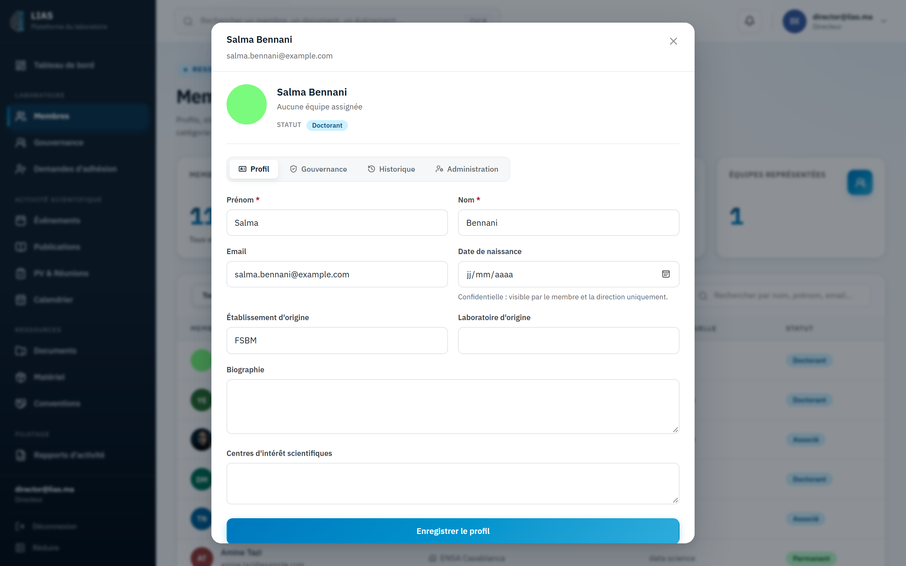

**Figure C.1** — Fiche membre — onglet Profil, champs éditables selon les droits


La figure C.1 illustre la règle d'édition décrite au
chapitre 5 : les champs sont actifs pour le propriétaire du profil et pour la
direction, et en lecture seule pour tout autre membre, avec un message explicite.


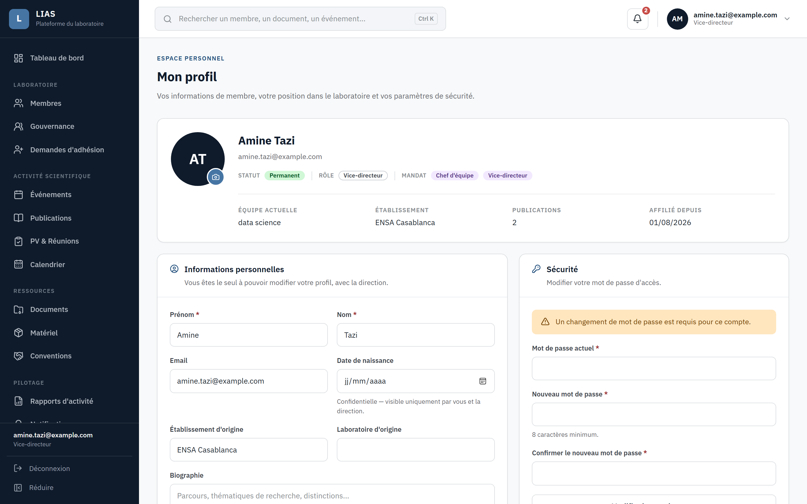

**Figure C.2** — Espace personnel — les trois notions STATUT, RÔLE et MANDAT affichées côte à côte


L'espace personnel, présenté en figure C.2, regroupe les informations
du membre connecté, sa position dans le laboratoire et le changement de mot de passe. Le
bandeau d'identité y donne l'illustration la plus directe de la règle centrale du projet :
le membre affiché a pour STATUT « Permanent », pour RÔLE effectif « Vice-directeur », et
détient simultanément deux MANDATs, « Chef d'équipe » et « Vice-directeur ». Les trois
valeurs diffèrent, et seule la deuxième est calculée — elle découle de la plus élevée des
deux responsabilités en cours, conformément à la règle de priorité du
listing 5.1.


# Reproduction de l'environnement


Les commandes ci-dessous permettent de reconstruire et de vérifier le projet. Elles
correspondent exactement à celles dont les résultats sont rapportés au
chapitre 8.


*Construction et vérification du projet*

```bash
# --- Configuration locale (valeurs a renseigner, fichier non versionne) ---
#   backend/.env  :  DB_HOST, DB_PORT, DB_NAME, DB_USERNAME, DB_PASSWORD,
#                    MAIL_HOST, MAIL_PORT, MAIL_USERNAME, MAIL_PASSWORD,
#                    JWT_SECRET, FILE_STORAGE_DIR
#   Le modele complet se trouve dans backend/.env.example

# --- Backend : compilation et tests ---
cd backend
set JAVA_HOME=<chemin du JDK 21>
.maven\apache-maven-3.9.16\bin\mvn.cmd clean compile
.maven\apache-maven-3.9.16\bin\mvn.cmd clean test      # 48 tests

# --- Backend : execution ---
.maven\apache-maven-3.9.16\bin\mvn.cmd spring-boot:run

# --- Frontend : construction, analyse statique, execution ---
cd ../frontend
npm install
npm run build
npx oxlint
npm run dev
```


La documentation interactive de l'API est accessible, l'application démarrée, à l'adresse
`/swagger-ui.html`. Les diagrammes UML sources, au format Mermaid, se trouvent dans
`docs/uml/` ; les images de ce rapport en sont le rendu direct.
